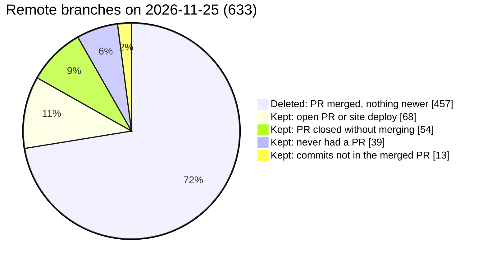

# 2026-11-25: one-time cleanup of merged branches

Policy and restore steps: [BRANCH_HYGIENE.md](../BRANCH_HYGIENE.md).

## What happened

On 2026-11-25 the repository had 633 remote branches besides `main` and `develop`, most of them left behind by merged PRs. The same day, "Automatically delete head branches" was turned on so merged branches no longer pile up, and the existing merged branches were deleted once.

- **Deleted: 457 branches.** Each one's PR merged, and the branch tip was the PR's merged head commit or older. Just before deleting, every branch was checked again: tip unchanged, not protected, not the head or base of an open PR.
- **Kept: everything else.** 54 branches whose PR closed without merging, 39 that never had a PR, 13 whose merged PR doesn't contain all of their commits, and 68 used by an open PR or the site deploy. Their owners decide what happens to them.

## Kept: merged PR, but the branch has commits the PR doesn't

These PRs merged, but each branch holds commits that never reached the merged PR head. They are possibly unmerged work, so they were not deleted. The owner should check them and delete the branch when done.

| Branch | PR | Owner | Merged | Last commit | Commits not in the PR |
|---|---|---|---|---|---|
| `app-layer-scaffolding` | [#5](https://github.com/unicef/adt-studio/pull/5) Add app layer scaffolding: Hono API + React SPA | amoghbanta | 2026-02-10 | 2026-02-10 | 3 (by amoghbanta) |
| `elasticsounds/shared-google-gemini-key` | [#973](https://github.com/unicef/adt-studio/pull/973) feat(providers): let Gemini Speech fall back to the Google API key | elasticsounds | 2026-10-21 | 2026-10-20 | 1 (by elasticsounds) |
| `elasticsounds/speech-model-per-provider` | [#978](https://github.com/unicef/adt-studio/pull/978) fix(speech): apply the global speech model only to its own provider | elasticsounds | 2026-10-21 | 2026-10-20 | 1 (by elasticsounds) |
| `eliezir/onboarding-redesign` | [#771](https://github.com/unicef/adt-studio/pull/771) Onboarding redesign — desktop-first first-run flow (light/dark, stable/beta) | Eliezir | 2026-08-11 | 2026-08-11 | 2 (by Eliezir) |
| `feat/desktop-sidecar-bundling` | [#39](https://github.com/unicef/adt-studio/pull/39) Bundle API server as Tauri sidecar with Windows release pipeline | amoghbanta | 2026-02-13 | 2026-02-13 | 1 (by amoghbanta) |
| `feat/proof-phase-frontend` | [#42](https://github.com/unicef/adt-studio/pull/42) Add proof phase frontend integration | amoghbanta | 2026-02-14 | 2026-02-16 | 18 (by amoghbanta,nicpottier) |
| `fix/language-picker-dropdown` | [#48](https://github.com/unicef/adt-studio/pull/48) Replace language picker with searchable dropdown | amoghbanta | 2026-02-16 | 2026-02-16 | 1 (by amoghbanta) |
| `fix/storyboard-navigation-bugs` | [#95](https://github.com/unicef/adt-studio/pull/95) fix: storyboard page height, navigation race conditions, and image selectability | amoghbanta | 2026-02-20 | 2026-02-20 | 1 (by amoghbanta) |
| `increment-5-pipeline-ux` | [#22](https://github.com/unicef/adt-studio/pull/22) Add API key setup dialog on app launch | amoghbanta | 2026-02-12 | 2026-02-12 | 4 (by amoghbanta) |
| `nicpottier/book-creation-flow` | [#57](https://github.com/unicef/adt-studio/pull/57) Redirect book creation to v2 with extract+storyboard steps | nicpottier | 2026-02-17 | 2026-02-17 | 1 (by nicpottier) |
| `nicpottier/check-release-action` | [#80](https://github.com/unicef/adt-studio/pull/80) Switch release workflow from deploy branch to tag-triggered | nicpottier | 2026-02-19 | 2026-02-19 | 1 (by nicpottier) |
| `nicpottier/fix-assets` | [#106](https://github.com/unicef/adt-studio/pull/106) fix: include config/ and assets/ in Docker and Tauri builds | nicpottier | 2026-02-22 | 2026-02-21 | 5 (by nicpottier) |
| `tauri-desktop-scaffold` | [#23](https://github.com/unicef/adt-studio/pull/23) Add Tauri desktop app scaffolding | amoghbanta | 2026-02-12 | 2026-02-12 | 1 (by amoghbanta) |

## Kept: owners decide (PR closed unmerged, or no PR)

These branches are only counted, because the list changes as owners act on it. To see the current state, list remote branches and check each one's PR, following rule 3 in [BRANCH_HYGIENE.md](../BRANCH_HYGIENE.md#the-rules).

| Owner | PR closed without merging | Never had a PR |
|---|---|---|
| Eliezir | 18 | 13 |
| elasticsounds | 17 | 3 |
| zignaggo | 1 | 9 |
| gbergengruen | 7 |  |
| nicpottier | 2 | 3 |
| caroline-ssantoss | 3 |  |
| KaReeeeeeeeEM | 2 | 1 |
| cristobaliugo |  | 2 |
| flamurbeqiraj |  | 2 |
| github-actions[bot] |  | 2 |
| ksokolovic |  | 2 |
| amoghbanta |  | 1 |
| kinggamma | 1 |  |
| Mominadar | 1 |  |
| ravi-adt | 1 |  |
| simba-mudz | 1 |  |
| VictorBrasileiroo |  | 1 |

## Deleted branches (457)

To restore one, use **Restore branch** on its PR page, or push the tip commit back (see [Restoring a deleted branch](../BRANCH_HYGIENE.md#restoring-a-deleted-branch)).

Full list with tip commits

| Branch | PR | Owner | Merged | Tip commit |
|---|---|---|---|---|
| `adt-fixes` | [#70](https://github.com/unicef/adt-studio/pull/70) | nicpottier | 2026-02-18 | `4ca1f7dfaeef7fdc89d08bbdb601dccb91c55f34` |
| `agents/multiple-voices-speech-feature` | [#780](https://github.com/unicef/adt-studio/pull/780) | gaguerre-iugo | 2026-08-28 | `87cc88b680b804ae39fa677ba92bda3d76eba621` |
| `bundlejs-test` | [#187](https://github.com/unicef/adt-studio/pull/187) | gbergengruen | 2026-03-18 | `a7b9f3f5d1f0be0a03c300555edaf5850b141907` |
| `chore/bump-desktop-rc8` | [#432](https://github.com/unicef/adt-studio/pull/432) | Eliezir | 2026-05-25 | `f208c6ea2e7ca4e07dddfe30266343ea46d8a4c1` |
| `chore/gitignore-hygiene` | [#486](https://github.com/unicef/adt-studio/pull/486) | gbergengruen | 2026-06-23 | `d4041f85eb7c6533dc809ef7d59583d4ba63ee87` |
| `chore/update-deps` | [#521](https://github.com/unicef/adt-studio/pull/521) | zignaggo | 2026-07-02 | `0b11f4fd3ac919cc6c5f87e276d3f2fd3bdfce8a` |
| `codex/1107-section-merge-html` | [#1150](https://github.com/unicef/adt-studio/pull/1150) | gbergengruen | 2026-11-18 | `7f44e82c4cb63cc5ce9618d5136caa65b6167a6b` |
| `codex/714-whisper-debug-log` | [#798](https://github.com/unicef/adt-studio/pull/798) | gbergengruen | 2026-09-01 | `2dec2c894e34f4a24afc3bc25af37e0d75fc0990` |
| `codex/715-cli-tts-debug-log` | [#799](https://github.com/unicef/adt-studio/pull/799) | gbergengruen | 2026-08-17 | `15f510929a9103461b757d777df19a897bb73b4e` |
| `codex/719-tts-log-builder` | [#797](https://github.com/unicef/adt-studio/pull/797) | gbergengruen | 2026-08-12 | `b3263186dc336a79411e189e21a575afbdcf46f3` |
| `codex/720-azure-tts-audio-options` | [#789](https://github.com/unicef/adt-studio/pull/789) | gbergengruen | 2026-08-12 | `de6449b28f8c75a403713f114e340698c4e5c712` |
| `codex/fix-815-sectioning-drag-opacity` | [#845](https://github.com/unicef/adt-studio/pull/845) | gbergengruen | 2026-09-07 | `2a0c483a2c2b7403482a586ce027ff2ac3469a78` |
| `codex/fix-pipeline-step-label-translations` | [#828](https://github.com/unicef/adt-studio/pull/828) | gbergengruen | 2026-08-31 | `a8f05cf9f334984862be87dac164e16c44005703` |
| `codex/fix-sign-language-assignment-picker` | [#838](https://github.com/unicef/adt-studio/pull/838) | gbergengruen | 2026-09-02 | `b81aba2bbfcdd8a757f142d8d8e179943f005a7e` |
| `codex/security-critical-deps` | [#1151](https://github.com/unicef/adt-studio/pull/1151) | gbergengruen | 2026-11-18 | `d6b5a700b6a71f4ef04df0235eb49a38d8d4ca70` |
| `codex/storyboard-menu-portal` | [#776](https://github.com/unicef/adt-studio/pull/776) | gbergengruen | 2026-08-11 | `555392088dd1eff7398048c5d863057d8986ce94` |
| `copilot/create-first-version-of-wiki` | [#353](https://github.com/unicef/adt-studio/pull/353) | Copilot | 2026-04-28 | `3e833f81dea3dfbd0c85c4d1caa3f19aed191b7a` |
| `developer-guide` | [#120](https://github.com/unicef/adt-studio/pull/120) | gbergengruen | 2026-02-24 | `97fbd32f0a9c6ce2093fb8f98e3da7b0066acd8e` |
| `docker-playwright-fix` | [#188](https://github.com/unicef/adt-studio/pull/188) | gbergengruen | 2026-03-18 | `1f40cf32e2b377d588c185410545865bdf8173ed` |
| `docker-preview-fix` | [#111](https://github.com/unicef/adt-studio/pull/111) | gbergengruen | 2026-02-23 | `ce875cfd45e323f34a1838f276beea3e1765c162` |
| `docker-version` | [#38](https://github.com/unicef/adt-studio/pull/38) | gbergengruen | 2026-02-20 | `ef6b953ba263e54dba279ca1c71f6496d221db37` |
| `docs/1059-sdd-size-thresholds` | [#1060](https://github.com/unicef/adt-studio/pull/1060) | gbergengruen | 2026-11-02 | `d43b7785ded84fb33be4f31f85002e037d01e721` |
| `docs/enable-site-docs` | [#563](https://github.com/unicef/adt-studio/pull/563) | Eliezir | 2026-07-24 | `593b20f7e267b16755ac4db9b62fb00ca5af37fb` |
| `docs/security-policy` | [#1111](https://github.com/unicef/adt-studio/pull/1111) | gbergengruen | 2026-11-13 | `2dc0587bb1d5de70becce29013f2687d2b72887a` |
| `elasticsounds-patch-1` | [#354](https://github.com/unicef/adt-studio/pull/354) | elasticsounds | 2026-04-28 | `6dd4f2660e92837cbc6aeb01b443aec34726e9a2` |
| `elasticsounds-patch-2` | [#356](https://github.com/unicef/adt-studio/pull/356) | elasticsounds | 2026-04-28 | `cd6a464314cf3a92e4e608d19f83d84432c4e476` |
| `elasticsounds-patch-3` | [#357](https://github.com/unicef/adt-studio/pull/357) | elasticsounds | 2026-04-28 | `53eea5d4eee44cd9840dcf3641b7cb8b4f4da000` |
| `elasticsounds-patch-4` | [#358](https://github.com/unicef/adt-studio/pull/358) | elasticsounds | 2026-04-28 | `63575a414cff2b4a321b8cc137d040bd03402366` |
| `elasticsounds-patch-5` | [#359](https://github.com/unicef/adt-studio/pull/359) | elasticsounds | 2026-04-28 | `04b0a6fe31040436939a1fea8fa3a98625f4e011` |
| `elasticsounds-patch-6` | [#360](https://github.com/unicef/adt-studio/pull/360) | elasticsounds | 2026-04-28 | `c1c16188c19d972393e01ec097eee956cd9650ea` |
| `elasticsounds-patch-7` | [#364](https://github.com/unicef/adt-studio/pull/364) | elasticsounds | 2026-04-29 | `72eff841d6e2eccf8eba6d1bf89f751227564f80` |
| `elasticsounds-patch-8` | [#365](https://github.com/unicef/adt-studio/pull/365) | elasticsounds | 2026-04-29 | `ddeae16493c56c581cb45257fb973f9f1c7449cd` |
| `elasticsounds/activity-rendering` | [#74](https://github.com/unicef/adt-studio/pull/74) | elasticsounds | 2026-02-18 | `93bb3f8376de47f26237c986f2f24b40aa476811` |
| `elasticsounds/activity-type-modules-not-loading` | [#441](https://github.com/unicef/adt-studio/pull/441) | elasticsounds | 2026-05-29 | `e9d72497833850cdce60700f34802d935d86a94d` |
| `elasticsounds/add-albanian-locale` | [#444](https://github.com/unicef/adt-studio/pull/444) | elasticsounds | 2026-05-28 | `6b9a332b9f5bf1d1bf4a24b908f5a450046a66db` |
| `elasticsounds/add-french-locale` | [#283](https://github.com/unicef/adt-studio/pull/283) | elasticsounds | 2026-04-16 | `ab2d92ee53165fbf8adb9b935750b933e2b98bb8` |
| `elasticsounds/add-languages` | [#336](https://github.com/unicef/adt-studio/pull/336) | elasticsounds | 2026-04-26 | `30ae87f5922a894fb8385ee7e2125c7167677025` |
| `elasticsounds/add-two-col-story` | [#50](https://github.com/unicef/adt-studio/pull/50) | elasticsounds | 2026-02-16 | `d3abdde7ea76d6d147380a66094e6fb19f15cfc2` |
| `elasticsounds/arrow-key-menu-trap` | [#457](https://github.com/unicef/adt-studio/pull/457) | elasticsounds | 2026-05-31 | `07cb016832cd3040aea2eb7e9ee0d7eb2b651ebd` |
| `elasticsounds/auto-start-extract` | [#459](https://github.com/unicef/adt-studio/pull/459) | elasticsounds | 2026-05-31 | `3118030a261c27bf707ea372f710d24e0aac8b4c` |
| `elasticsounds/azure-tts-config` | [#76](https://github.com/unicef/adt-studio/pull/76) | elasticsounds | 2026-02-19 | `0cc0fd3c2695a4cc5a1901dd704036dbd704c33c` |
| `elasticsounds/book-covers` | [#389](https://github.com/unicef/adt-studio/pull/389) | elasticsounds | 2026-05-05 | `1dc87d1237ca07577b8ddcc4ee059138805c23ce` |
| `elasticsounds/book-outline-step-error` | [#1036](https://github.com/unicef/adt-studio/pull/1036) | elasticsounds | 2026-11-23 | `18beffa721fe3c8c9dbeaa2401330bddb0ee7548` |
| `elasticsounds/caption-editor-ux-improvements` | [#447](https://github.com/unicef/adt-studio/pull/447) | elasticsounds | 2026-05-31 | `68a338c71522e1d1568ae19d816d671efef120c5` |
| `elasticsounds/check-gemini-tts` | [#476](https://github.com/unicef/adt-studio/pull/476) | elasticsounds | 2026-06-03 | `305217f494fa813e929e05636b2c9336c049d61f` |
| `elasticsounds/core-tts-catalog` | [#742](https://github.com/unicef/adt-studio/pull/742) | elasticsounds | 2026-08-07 | `0953878cb9269617f1afa7f15f65649247c0f5f8` |
| `elasticsounds/crop-aspect-ratio-lock` | [#523](https://github.com/unicef/adt-studio/pull/523) | elasticsounds | 2026-06-28 | `1d565c2ff476f84aa661dd0fbccdb347d1d95fbe` |
| `elasticsounds/crop-tool-drag/move-issue` | [#991](https://github.com/unicef/adt-studio/pull/991) | elasticsounds | 2026-11-01 | `b29fe58a200e55963d79f86fd41370f297426c30` |
| `elasticsounds/crop-ui-segment-style` | [#229](https://github.com/unicef/adt-studio/pull/229) | elasticsounds | 2026-04-01 | `901773d528290b0a51716db9d85c37157bfd079e` |
| `elasticsounds/cross-page-section-merging` | [#571](https://github.com/unicef/adt-studio/pull/571) | elasticsounds | 2026-07-17 | `7833a02a90d0a79f7a499fcbb2657a0056d806f8` |
| `elasticsounds/cross-page-sectioning` | [#232](https://github.com/unicef/adt-studio/pull/232) | elasticsounds | 2026-04-03 | `67f05a2da965c2f64ac79eda654b6dcb3ee23359` |
| `elasticsounds/custom-layout-editor` | [#52](https://github.com/unicef/adt-studio/pull/52) | elasticsounds | 2026-02-16 | `2308c9eef52cd8567edfc03ca4065ebada06428d` |
| `elasticsounds/dakar` | [#461](https://github.com/unicef/adt-studio/pull/461) | elasticsounds | 2026-05-31 | `5a65739a309c7f7b35534ee3460c9cb5e9f7feab` |
| `elasticsounds/decouple-extract-storyboard` | [#244](https://github.com/unicef/adt-studio/pull/244) | elasticsounds | 2026-04-03 | `c56cf1536347099720ecb38a82000a00bef1c941` |
| `elasticsounds/dedupe-pdf-labels` | [#234](https://github.com/unicef/adt-studio/pull/234) | elasticsounds | 2026-04-03 | `a568816df147835c47d677df30181bc82a576846` |
| `elasticsounds/dynamic-section-prompt` | [#175](https://github.com/unicef/adt-studio/pull/175) | elasticsounds | 2026-03-12 | `178ac52aa2749bb95aedf5bf075373895398258b` |
| `elasticsounds/easy-read-skip-flow` | [#471](https://github.com/unicef/adt-studio/pull/471) | elasticsounds | 2026-06-03 | `f59f7a8644cb588c557eebd39006cfa4bb7b3582` |
| `elasticsounds/editable-inputs` | [#294](https://github.com/unicef/adt-studio/pull/294) | elasticsounds | 2026-04-19 | `9571660676f135e6a193cb304591d2e4b1dd2b90` |
| `elasticsounds/element-style-editor` | [#231](https://github.com/unicef/adt-studio/pull/231) | elasticsounds | 2026-04-03 | `08a7bad119eb4ac0ab4e319cb77d898c81fa72bd` |
| `elasticsounds/export-lang-bug` | [#319](https://github.com/unicef/adt-studio/pull/319) | elasticsounds | 2026-04-23 | `2ab0e6150c28c36a5f3edf860eec756c9e0e1f3d` |
| `elasticsounds/extract-issues-report-script` | [#615](https://github.com/unicef/adt-studio/pull/615) | elasticsounds | 2026-07-27 | `331ba8bdca6d7164c108e5e133f6a743b86a89c8` |
| `elasticsounds/extract-start-feedback-delay` | [#616](https://github.com/unicef/adt-studio/pull/616) | elasticsounds | 2026-07-27 | `25e801e978c2a67a0717e1d19db78686e701f1e6` |
| `elasticsounds/extraction-pdf-status` | [#1002](https://github.com/unicef/adt-studio/pull/1002) | elasticsounds | 2026-10-25 | `fa5f931b8f03e563a1f53c7959cf4fb93cf79a24` |
| `elasticsounds/figure-grouping` | [#221](https://github.com/unicef/adt-studio/pull/221) | elasticsounds | 2026-04-02 | `20228bef6486db1020ca60c42ddec27451a68ad4` |
| `elasticsounds/fitb-inline-inputs` | [#219](https://github.com/unicef/adt-studio/pull/219) | elasticsounds | 2026-04-02 | `4dbb77495ea9b428aca86c8bdf8a00c2140e665c` |
| `elasticsounds/fitb-validation` | [#373](https://github.com/unicef/adt-studio/pull/373) | elasticsounds | 2026-05-04 | `55336b60d0e20f79104150bf971b94d60e5cc77a` |
| `elasticsounds/fix-activity-preview-buttons` | [#158](https://github.com/unicef/adt-studio/pull/158) | elasticsounds | 2026-03-09 | `58e889bea4482ba3631e9280bbe3f4dd43f7d567` |
| `elasticsounds/fix-container-delete` | [#176](https://github.com/unicef/adt-studio/pull/176) | elasticsounds | 2026-03-12 | `91e77f0dee76c77dc57065c8b749bc9e44665a04` |
| `elasticsounds/fix-delete-colored-blocks` | [#772](https://github.com/unicef/adt-studio/pull/772) | elasticsounds | 2026-08-11 | `cda6b14af409de4751e48d664b219bd0bf245fe3` |
| `elasticsounds/fix-i18n-extract` | [#362](https://github.com/unicef/adt-studio/pull/362) | elasticsounds | 2026-04-29 | `feba8fc9c1763abda5a47fa2aa4df34131ba406c` |
| `elasticsounds/fix-iframe-height` | [#169](https://github.com/unicef/adt-studio/pull/169) | elasticsounds | 2026-03-10 | `91f3cc933e7de4f15c78b57e63c902e733f14f90` |
| `elasticsounds/fix-image-sectioning` | [#152](https://github.com/unicef/adt-studio/pull/152) | elasticsounds | 2026-03-09 | `49529962c994c6f1e47c6fe2615d0bd5e04f2217` |
| `elasticsounds/fix-latex-mathml` | [#216](https://github.com/unicef/adt-studio/pull/216) | elasticsounds | 2026-03-30 | `7c881b6371f3330ab5cde087767d2a0be9072423` |
| `elasticsounds/fix-playwright-browsers` | [#164](https://github.com/unicef/adt-studio/pull/164) | elasticsounds | 2026-03-09 | `bda65042c2896ba9e22e4d11cfbe8ea6943e2ca8` |
| `elasticsounds/fix-regenerate-prompt` | [#166](https://github.com/unicef/adt-studio/pull/166) | elasticsounds | 2026-03-10 | `f8c7655a64667e5673c9f58d22db2b7e3da1a5c0` |
| `elasticsounds/fix-route-warning` | [#303](https://github.com/unicef/adt-studio/pull/303) | elasticsounds | 2026-04-19 | `c8cb110b6906ec26ba3acb72f37e7044e9f83efd` |
| `elasticsounds/fix-section-menu-scroll` | [#170](https://github.com/unicef/adt-studio/pull/170) | elasticsounds | 2026-03-10 | `bab6771aaa941562ab7ba3c8438a6ef1d9e09f64` |
| `elasticsounds/fix-sectioning-issues` | [#374](https://github.com/unicef/adt-studio/pull/374) | elasticsounds | 2026-05-04 | `b15da623edb5a9cac00c3ee4dc3689a2a1c93cc4` |
| `elasticsounds/fix-textfield-cursor` | [#296](https://github.com/unicef/adt-studio/pull/296) | elasticsounds | 2026-04-19 | `183f5cb5dd262dde6c4f5f264af1b826fee9864d` |
| `elasticsounds/fix-toc-generation` | [#193](https://github.com/unicef/adt-studio/pull/193) | elasticsounds | 2026-03-22 | `b0e6bcc96ee9fa70f091984afd9dab138fe03526` |
| `elasticsounds/fix-toc-pipeline` | [#199](https://github.com/unicef/adt-studio/pull/199) | elasticsounds | 2026-03-23 | `2f8198835479770a1246e5e2405ba0385047f9c1` |
| `elasticsounds/fixed-layout-duplicate-bg` | [#524](https://github.com/unicef/adt-studio/pull/524) | elasticsounds | 2026-06-29 | `5b11a7a40910a5415f24618d382195d58612797a` |
| `elasticsounds/fixed-layout-greyed-out` | [#449](https://github.com/unicef/adt-studio/pull/449) | elasticsounds | 2026-05-29 | `4dc7479cdc27d2273521f56047d144838537cce0` |
| `elasticsounds/fixed-layout-single-page-sizing` | [#458](https://github.com/unicef/adt-studio/pull/458) | elasticsounds | 2026-05-31 | `9c3008f6d34fa9f3cb484ba33d48bfa8a1264097` |
| `elasticsounds/fixed-layout-warnings` | [#600](https://github.com/unicef/adt-studio/pull/600) | elasticsounds | 2026-07-24 | `605a40c9b5919ebd71093282d3e9d4a974bf4629` |
| `elasticsounds/fl-save-strips-container` | [#473](https://github.com/unicef/adt-studio/pull/473) | elasticsounds | 2026-08-05 | `c0a0ce49871e2984fd1d8c90128d11e70f816225` |
| `elasticsounds/gemini-key-e2e-pipeline` | [#966](https://github.com/unicef/adt-studio/pull/966) | elasticsounds | 2026-10-27 | `79f85760609f55952b99c622ff270217f22f3a31` |
| `elasticsounds/gemini-speech-health-check` | [#980](https://github.com/unicef/adt-studio/pull/980) | elasticsounds | 2026-10-21 | `2e24b9b561da7d2418f08c256d9222c198b3ad7b` |
| `elasticsounds/gemini-tts-rate-limits` | [#575](https://github.com/unicef/adt-studio/pull/575) | elasticsounds | 2026-07-18 | `53b2f70d310dce6a0bb57021994a5ce4a30a3456` |
| `elasticsounds/gen-styleguide` | [#156](https://github.com/unicef/adt-studio/pull/156) | elasticsounds | 2026-03-09 | `1f7af263d871efe686c922df8fac04b75386a5bf` |
| `elasticsounds/git-pull` | [#1140](https://github.com/unicef/adt-studio/pull/1140) | elasticsounds | 2026-11-16 | `794593c6a2ccd8f335e970700f318a2c996d21e6` |
| `elasticsounds/gk-2.pdf-watermark-check` | [#1106](https://github.com/unicef/adt-studio/pull/1106) | elasticsounds | 2026-11-15 | `e8c8c4e0fd83658579381560aee4e7580c28d130` |
| `elasticsounds/glossary-autofill` | [#318](https://github.com/unicef/adt-studio/pull/318) | elasticsounds | 2026-04-22 | `9c776672bae11605ed919b6e77b738fc955390b7` |
| `elasticsounds/glossary-autofill-bug` | [#334](https://github.com/unicef/adt-studio/pull/334) | elasticsounds | 2026-04-26 | `cdb98be5928e518670e2532088fd0c67f6ea25a8` |
| `elasticsounds/glossary-page-adaptation` | [#609](https://github.com/unicef/adt-studio/pull/609) | elasticsounds | 2026-07-27 | `555c451de0f0ed17249e24547e4ec0f764147828` |
| `elasticsounds/glossary-prune` | [#382](https://github.com/unicef/adt-studio/pull/382) | elasticsounds | 2026-05-04 | `0fba0d1e96154f1c9410d90f336d9ac734081f85` |
| `elasticsounds/gpt-images-2.6-flare-upgrade` | [#1203](https://github.com/unicef/adt-studio/pull/1203) | elasticsounds | 2026-11-23 | `da85ce45c543d0b53821d1ee621590f2d7e557d1` |
| `elasticsounds/grey-out-stage-icons` | [#346](https://github.com/unicef/adt-studio/pull/346) | elasticsounds | 2026-04-27 | `f31b2232390927a62c5b7df25f27cc4b3df16f55` |
| `elasticsounds/hide-two-column` | [#298](https://github.com/unicef/adt-studio/pull/298) | elasticsounds | 2026-04-19 | `33dfc8bf6c6b29733bafcd3da3be35ef65b77ed3` |
| `elasticsounds/hide-wizard-example-links` | [#826](https://github.com/unicef/adt-studio/pull/826) | elasticsounds | 2026-08-29 | `d51c5176c171c38ca00ac3022524743a1e90a108` |
| `elasticsounds/home-page-pipeline-grouping` | [#446](https://github.com/unicef/adt-studio/pull/446) | elasticsounds | 2026-05-31 | `2715e184349e3ebfc266293ff24396c88941e624` |
| `elasticsounds/image-edit-placement` | [#261](https://github.com/unicef/adt-studio/pull/261) | elasticsounds | 2026-04-06 | `f059debf29a3820d2d64fb1423b17ade9d4dde8e` |
| `elasticsounds/image-gen-prompts` | [#174](https://github.com/unicef/adt-studio/pull/174) | elasticsounds | 2026-03-12 | `80c754ec77df29610bcde358b7c3087fac7aa598` |
| `elasticsounds/image-localization` | [#347](https://github.com/unicef/adt-studio/pull/347) | elasticsounds | 2026-04-29 | `2c1edbc61f66d71d70c2e9b73fafd3029d3ec32a` |
| `elasticsounds/image-recrop-popup` | [#257](https://github.com/unicef/adt-studio/pull/257) | elasticsounds | 2026-04-05 | `145c09912a76a9d2a8c5c729cec757ad2a6cfb87` |
| `elasticsounds/image-replace-options` | [#260](https://github.com/unicef/adt-studio/pull/260) | elasticsounds | 2026-04-06 | `d91f0fedf6dcaaae9029079abd6a1b4a5872425a` |
| `elasticsounds/image-to-page-extraction` | [#1104](https://github.com/unicef/adt-studio/pull/1104) | elasticsounds | 2026-11-13 | `9afa33b0eca44dff2d3fc694310c8945da55ae34` |
| `elasticsounds/img-trans-gpt2-default` | [#380](https://github.com/unicef/adt-studio/pull/380) | elasticsounds | 2026-05-04 | `cd425f2544bdadee565c109c45878d488bc97a15` |
| `elasticsounds/issue-746-fix` | [#748](https://github.com/unicef/adt-studio/pull/748) | elasticsounds | 2026-08-07 | `4d63d119de580ab49f5c8968638b61d411ff96d0` |
| `elasticsounds/keep-cover-credits-default` | [#738](https://github.com/unicef/adt-studio/pull/738) | elasticsounds | 2026-08-05 | `33c2873e7e9d225882a24704ddf7d17a06083f34` |
| `elasticsounds/kelowna` | [#474](https://github.com/unicef/adt-studio/pull/474) | elasticsounds | 2026-06-03 | `4bc27260de69dc3fd4eb82f793a434897f8e123b` |
| `elasticsounds/kid-friendly-styleguide` | [#101](https://github.com/unicef/adt-studio/pull/101) | elasticsounds | 2026-02-20 | `e15afd5063b09124f57376fa22e6a8fd6353855e` |
| `elasticsounds/latex-underscore-fix` | [#291](https://github.com/unicef/adt-studio/pull/291) | elasticsounds | 2026-04-17 | `03e892bbbe508336ec47e8c046b63449a9cc8856` |
| `elasticsounds/llm-overlay-liquid` | [#110](https://github.com/unicef/adt-studio/pull/110) | elasticsounds | 2026-02-24 | `0a79a7fddc95ca38728c05674fadb5db677c9571` |
| `elasticsounds/localize-preview-settings` | [#741](https://github.com/unicef/adt-studio/pull/741) | elasticsounds | 2026-08-06 | `db9ed16134ec011b4765f8944c6e819ce9414054` |
| `elasticsounds/model-dropdowns` | [#248](https://github.com/unicef/adt-studio/pull/248) | elasticsounds | 2026-04-03 | `a3190410893aedb857effb1a46a71b41381fbe62` |
| `elasticsounds/move-spread-layout` | [#63](https://github.com/unicef/adt-studio/pull/63) | elasticsounds | 2026-02-17 | `a111b99bbc08baa6c1af0404fa39bbe651af32b8` |
| `elasticsounds/nano-banana-2` | [#904](https://github.com/unicef/adt-studio/pull/904) | elasticsounds | 2026-09-30 | `e9a6579898d50201a429e600cb4e76a622ca1545` |
| `elasticsounds/overview-edit-buttons` | [#249](https://github.com/unicef/adt-studio/pull/249) | elasticsounds | 2026-04-03 | `09ae1396bd008292f0d7ad7f5208fabe92777876` |
| `elasticsounds/pdf-extract-slowdown` | [#453](https://github.com/unicef/adt-studio/pull/453) | elasticsounds | 2026-05-31 | `c8fec9b12b8e19c00234e0ae1b276366ed18d511` |
| `elasticsounds/pdf-memory-audit` | [#204](https://github.com/unicef/adt-studio/pull/204) | elasticsounds | 2026-04-03 | `57c10bbef3df9051dd953358c33056f76d88ac83` |
| `elasticsounds/persist-storyboard-page` | [#104](https://github.com/unicef/adt-studio/pull/104) | elasticsounds | 2026-02-20 | `5e07038628347e45757b1da7a44d08bec6fd4bdd` |
| `elasticsounds/polygon-crop` | [#239](https://github.com/unicef/adt-studio/pull/239) | elasticsounds | 2026-04-03 | `fa68e5632cbc2c6c3ba4a7eb995fd4df549c8c07` |
| `elasticsounds/port-layout-codex-agents` | [#541](https://github.com/unicef/adt-studio/pull/541) | Eliezir | 2026-07-29 | `2be25f36038987b135447da77f9058121dcd90c2` |
| `elasticsounds/port-pdf-image-color-fixes` | [#442](https://github.com/unicef/adt-studio/pull/442) | elasticsounds | 2026-05-27 | `a2ad36d73da635e4a7d6dfbf81a3fa29fd8be5ee` |
| `elasticsounds/port-sorting-activity` | [#460](https://github.com/unicef/adt-studio/pull/460) | elasticsounds | 2026-05-31 | `472aae34de126349e59d894debc34507e39c3287` |
| `elasticsounds/pr-bug-review` | [#414](https://github.com/unicef/adt-studio/pull/414) | elasticsounds | 2026-05-13 | `7c4025754ed76d36c06829a963c70448722bec33` |
| `elasticsounds/pr-review-fixes` | [#332](https://github.com/unicef/adt-studio/pull/332) | elasticsounds | 2026-04-26 | `e4cb99e71cc5a8995da42f9b33c3995289d099d8` |
| `elasticsounds/preview-js-activities` | [#153](https://github.com/unicef/adt-studio/pull/153) | elasticsounds | 2026-03-09 | `3d923cb961ebeed635d5d9597bb68c2e0626c8e4` |
| `elasticsounds/preview-mathml-not-rendering` | [#472](https://github.com/unicef/adt-studio/pull/472) | elasticsounds | 2026-06-03 | `997524df7baf7038fe74936c86f4c2f1ca533e64` |
| `elasticsounds/progressive-extraction` | [#259](https://github.com/unicef/adt-studio/pull/259) | elasticsounds | 2026-04-06 | `75121165671164bd631bcd832c27a5fca60a86a7` |
| `elasticsounds/progressive-storyboard` | [#247](https://github.com/unicef/adt-studio/pull/247) | elasticsounds | 2026-04-03 | `2801e8329ed9093158914d419882538f28f89b14` |
| `elasticsounds/prune-text-groups` | [#252](https://github.com/unicef/adt-studio/pull/252) | elasticsounds | 2026-04-03 | `af2ab4832fc4283c4a3045db54b65fd8e39340db` |
| `elasticsounds/quiz-instant-answer` | [#610](https://github.com/unicef/adt-studio/pull/610) | elasticsounds | 2026-07-25 | `ed0cbc24e146308f22f5649eaf8996d2a6c114d0` |
| `elasticsounds/quiz-page-frequency-option` | [#462](https://github.com/unicef/adt-studio/pull/462) | elasticsounds | 2026-06-02 | `a568f78d9edd304899478338aa8219d66d99ad81` |
| `elasticsounds/remove-recommended-pill` | [#752](https://github.com/unicef/adt-studio/pull/752) | elasticsounds | 2026-08-07 | `c2a0d3f1eb9d382a67a818e61e34a90a43601e3d` |
| `elasticsounds/rename-captions-ui` | [#258](https://github.com/unicef/adt-studio/pull/258) | elasticsounds | 2026-04-05 | `947892f83df40b5da27e0c885b50b095721a5910` |
| `elasticsounds/review-image-flip-fix` | [#739](https://github.com/unicef/adt-studio/pull/739) | elasticsounds | 2026-08-06 | `b68b1eabb67374250d5a4483d6bf806dfb1a809c` |
| `elasticsounds/review-word-highlight` | [#361](https://github.com/unicef/adt-studio/pull/361) | elasticsounds | 2026-04-29 | `b2c06ad65c41b94653f2b2d1900b47ebd7eadda9` |
| `elasticsounds/right-to-left-urdu-fix` | [#1114](https://github.com/unicef/adt-studio/pull/1114) | elasticsounds | 2026-11-13 | `2c5b3053238cefd7229caef820386a9b480c16c6` |
| `elasticsounds/screen-reader-audit` | [#507](https://github.com/unicef/adt-studio/pull/507) | elasticsounds | 2026-06-22 | `8ab4877f6270320cca5c6b9f54c01b958ea6f125` |
| `elasticsounds/section-by-page-mode` | [#75](https://github.com/unicef/adt-studio/pull/75) | elasticsounds | 2026-02-18 | `3094de42f223b917949586b6f465f6e480282b12` |
| `elasticsounds/section-editing` | [#162](https://github.com/unicef/adt-studio/pull/162) | elasticsounds | 2026-03-09 | `89ac2279fec384e2ef859264184e4a1c5e902016` |
| `elasticsounds/section-editor-migration` | [#314](https://github.com/unicef/adt-studio/pull/314) | elasticsounds | 2026-04-22 | `4e0322247bf104168bd27bd9f81aa6d55b26d02f` |
| `elasticsounds/section-pruning` | [#155](https://github.com/unicef/adt-studio/pull/155) | elasticsounds | 2026-03-09 | `17f1d60a4a8b80a3a9de2d22e5108bdd5674bdb6` |
| `elasticsounds/section-type-prompts` | [#194](https://github.com/unicef/adt-studio/pull/194) | elasticsounds | 2026-03-23 | `65c35a13ec4fd210e0942cb19c40c2a001c91558` |
| `elasticsounds/segment-image-tool` | [#522](https://github.com/unicef/adt-studio/pull/522) | elasticsounds | 2026-06-28 | `a88efb1e33392b3b31f94bcd705f979b3d53bffa` |
| `elasticsounds/settings-close-button` | [#269](https://github.com/unicef/adt-studio/pull/269) | elasticsounds | 2026-04-13 | `242860228c0db17e97ba5cb10d87b8b9c4dda46f` |
| `elasticsounds/sidebar-text-editing` | [#230](https://github.com/unicef/adt-studio/pull/230) | elasticsounds | 2026-04-02 | `c62bb7b553e4e36fbf412b7c8ae8f990d2be1838` |
| `elasticsounds/sign-language-videos` | [#255](https://github.com/unicef/adt-studio/pull/255) | elasticsounds | 2026-04-03 | `fb2333f7fcbc34feccf672de965658c9f9d971f9` |
| `elasticsounds/smart-image-extract` | [#96](https://github.com/unicef/adt-studio/pull/96) | elasticsounds | 2026-02-20 | `6d95e94923ef4f8096baefa70d9b0b0f44ac90f6` |
| `elasticsounds/sort-images-unpruned-first` | [#233](https://github.com/unicef/adt-studio/pull/233) | elasticsounds | 2026-04-03 | `a6c49663fc99a3205676285745f2776414bba3bd` |
| `elasticsounds/speech-preparation-prompt` | [#949](https://github.com/unicef/adt-studio/pull/949) | elasticsounds | 2026-10-11 | `5ba7f42117e9c6b3efb53f1d997ed2afd94e7273` |
| `elasticsounds/speech-prompts-load-bug` | [#636](https://github.com/unicef/adt-studio/pull/636) | elasticsounds | 2026-07-28 | `de75362708639d16a63fede7dd6bae6ca3524b45` |
| `elasticsounds/step-by-step-activity-mode` | [#578](https://github.com/unicef/adt-studio/pull/578) | elasticsounds | 2026-07-30 | `95e0f6025645c90c064e1dadc98363d7c945edd9` |
| `elasticsounds/storyboard-add-images` | [#157](https://github.com/unicef/adt-studio/pull/157) | elasticsounds | 2026-03-09 | `c09409b268da340a061495f8412ea1cc9c00a0c1` |
| `elasticsounds/storyboard-delete-preview` | [#165](https://github.com/unicef/adt-studio/pull/165) | elasticsounds | 2026-03-10 | `a99ede9cbf91654ca3ca684617010d5669b68ca7` |
| `elasticsounds/storyboard-edit-debug` | [#301](https://github.com/unicef/adt-studio/pull/301) | elasticsounds | 2026-04-19 | `f319c72ebeb1b170d981d227ccf7bf67e690fa54` |
| `elasticsounds/storyboard-gpt-image-2` | [#445](https://github.com/unicef/adt-studio/pull/445) | elasticsounds | 2026-05-28 | `7806bf1295145ce1ab730e3f74c2816f3af7caf0` |
| `elasticsounds/storyboard-html-preview` | [#168](https://github.com/unicef/adt-studio/pull/168) | elasticsounds | 2026-03-10 | `14dc64c1e8e88b2d8d1feed0b278d7e8ec74ec41` |
| `elasticsounds/storyboard-position-transform-panel` | [#740](https://github.com/unicef/adt-studio/pull/740) | elasticsounds | 2026-08-06 | `adbf7f7cbd90d3eeff98f6f5fe47f6b58ee04d22` |
| `elasticsounds/storyboard-save-invalidation` | [#737](https://github.com/unicef/adt-studio/pull/737) | elasticsounds | 2026-08-06 | `bd052c6cb5f13c9a0c4ce751101675489a54648a` |
| `elasticsounds/storyboard-section-nav` | [#154](https://github.com/unicef/adt-studio/pull/154) | elasticsounds | 2026-03-09 | `095b3947584aba4443bff4b20844edb4fdc58ac0` |
| `elasticsounds/storyboard-slow-start-logs` | [#839](https://github.com/unicef/adt-studio/pull/839) | elasticsounds | 2026-09-03 | `850e56c83078a7c3f44b0a81e0d799c22dba2426` |
| `elasticsounds/storyboard-submit-button` | [#440](https://github.com/unicef/adt-studio/pull/440) | elasticsounds | 2026-05-27 | `28506aeba8b0056320998a51fcdcbe7eaea36078` |
| `elasticsounds/table-extraction-review` | [#177](https://github.com/unicef/adt-studio/pull/177) | elasticsounds | 2026-03-12 | `d4544c86263eb1a38125dd13c0d4b440cc2c5f3b` |
| `elasticsounds/task-complete-sound` | [#256](https://github.com/unicef/adt-studio/pull/256) | elasticsounds | 2026-04-03 | `0472aec2fd598657975ca66616fe1efa9bea3d81` |
| `elasticsounds/thumbnail-section-count` | [#159](https://github.com/unicef/adt-studio/pull/159) | elasticsounds | 2026-03-09 | `d5afb6dfdc09b9b4e8db30c81181c5465ce2e45c` |
| `elasticsounds/tts-fixed-layout-text-jump` | [#604](https://github.com/unicef/adt-studio/pull/604) | elasticsounds | 2026-07-24 | `f87fea257a20e6d1d788443c8d927d9ba2d0ef29` |
| `elasticsounds/tts-normalization-disable-issue` | [#947](https://github.com/unicef/adt-studio/pull/947) | elasticsounds | 2026-10-15 | `7b5eb912f50f57fbb34bbc1b6fa6f980ea4e5405` |
| `elasticsounds/tts-panel-keyboard-autohide` | [#608](https://github.com/unicef/adt-studio/pull/608) | elasticsounds | 2026-07-24 | `2affc97b09fdceb0ebe283215fb25b4094e66d12` |
| `elasticsounds/tts-text-exclusion` | [#538](https://github.com/unicef/adt-studio/pull/538) | elasticsounds | 2026-07-03 | `f17fc96aa0e71dda4c2f932178f30058cf614d8c` |
| `elasticsounds/two-column-header-footer-pruning` | [#611](https://github.com/unicef/adt-studio/pull/611) | elasticsounds | 2026-07-26 | `a3b11d23cb1a837b573513d06c6dde82b8d910cf` |
| `elasticsounds/upload-img-toggles` | [#98](https://github.com/unicef/adt-studio/pull/98) | elasticsounds | 2026-02-20 | `0adce4c1671559758f7c4e67d50b423642ed7d02` |
| `elasticsounds/vector-text-toggle` | [#246](https://github.com/unicef/adt-studio/pull/246) | elasticsounds | 2026-04-03 | `e13712465517677871ef28fea0e91bc8541e2e31` |
| `elasticsounds/visual-review-prompt` | [#372](https://github.com/unicef/adt-studio/pull/372) | elasticsounds | 2026-05-04 | `bc7b5d10122bd2e7b20fdd3f6b5c859dc28455d3` |
| `elasticsounds/watermark-text-type` | [#732](https://github.com/unicef/adt-studio/pull/732) | elasticsounds | 2026-08-05 | `fa96c1a09c232c0c91ce3983429aa83323e85e8b` |
| `eliezir/935-topbar-drag-strip` | [#936](https://github.com/unicef/adt-studio/pull/936) | Eliezir | 2026-10-12 | `1d7f150dac306c3d7fbb4ff19e038411930b7b58` |
| `eliezir/activity-page-linking` | [#625](https://github.com/unicef/adt-studio/pull/625) | Eliezir | 2026-07-28 | `f00f7078e1a4f9a9c887fdcefbd3cf58a8350ca7` |
| `eliezir/add-albanian-locale` | [#467](https://github.com/unicef/adt-studio/pull/467) | Eliezir | 2026-06-02 | `82185c40a8c0c285e7a0d530948c8f796777a2fa` |
| `eliezir/agents-bridge-md` | [#420](https://github.com/unicef/adt-studio/pull/420) | Eliezir | 2026-05-15 | `cc08681be9f9b292cc0bc18ef5a2872cbeb2a12f` |
| `eliezir/app-icons` | [#426](https://github.com/unicef/adt-studio/pull/426) | Eliezir | 2026-05-19 | `6a5ef659ea1e6dbaaf251dec030ea58f9fc44b9a` |
| `eliezir/beta-release-asset-regeneration` | [#802](https://github.com/unicef/adt-studio/pull/802) | Eliezir | 2026-08-19 | `b89c4b6f686ecfd2fe13f47853385258b8e0f74c` |
| `eliezir/book-creation-wizard` | [#235](https://github.com/unicef/adt-studio/pull/235) | Eliezir | 2026-04-13 | `a52472dafebad135dc6284bc14f4677d7f7b083e` |
| `eliezir/book-metadata-editor-redesign` | [#485](https://github.com/unicef/adt-studio/pull/485) | Eliezir | 2026-06-05 | `22b8fd1305efe16bcaa14b5bad2220ffb17e8922` |
| `eliezir/book-sort` | [#305](https://github.com/unicef/adt-studio/pull/305) | Eliezir | 2026-04-20 | `0fafcf03d168a13e726d3a7ef32a1ef60182bb21` |
| `eliezir/chatgpt-signin-button` | [#843](https://github.com/unicef/adt-studio/pull/843) | Eliezir | 2026-09-03 | `16dcfcfcae020571d9e05693a00032e1064a6b3b` |
| `eliezir/ci-job-failure-check` | [#840](https://github.com/unicef/adt-studio/pull/840) | Eliezir | 2026-09-03 | `3dcad54ca94c5d937f32f9a73a1f684ad2683523` |
| `eliezir/cleanup-comments` | [#543](https://github.com/unicef/adt-studio/pull/543) | Eliezir | 2026-07-03 | `837e0e27e2a638153c82aa3ef69315c835f4812a` |
| `eliezir/cmdk-quick-actions` | [#832](https://github.com/unicef/adt-studio/pull/832) | Eliezir | 2026-09-02 | `696040649a6b7e07f7a6dd528014f58f249e5e5b` |
| `eliezir/collapse-a11y-alert` | [#398](https://github.com/unicef/adt-studio/pull/398) | Eliezir | 2026-05-07 | `986f3c781c68f94779e7f8909f65e03af6c4a9ef` |
| `eliezir/dedupe-empty-state` | [#436](https://github.com/unicef/adt-studio/pull/436) | Eliezir | 2026-05-28 | `3352835cc4ccbff7a632bf500d75902059665592` |
| `eliezir/dedupe-stage-content-guard` | [#437](https://github.com/unicef/adt-studio/pull/437) | Eliezir | 2026-05-29 | `37d02c48e1fd72d21cf1c3d462f0f2a8080263fb` |
| `eliezir/dedupe-version-picker` | [#435](https://github.com/unicef/adt-studio/pull/435) | Eliezir | 2026-06-02 | `fdb81aadce748f7754a5f28470d7d884b09df2fd` |
| `eliezir/demo-showcase` | [#564](https://github.com/unicef/adt-studio/pull/564) | Eliezir | 2026-07-14 | `a87d0d9963e908b0681c5ac70232f4b36063d208` |
| `eliezir/dev-port-conflicts` | [#312](https://github.com/unicef/adt-studio/pull/312) | Eliezir | 2026-04-20 | `8eb4c84139803cd2ba5148dc86aac0467bf66298` |
| `eliezir/disable-tw-editor-fixed-layout` | [#478](https://github.com/unicef/adt-studio/pull/478) | Eliezir | 2026-06-03 | `7eaf232c9d47ac732a6fdc1532f74e113a782cf1` |
| `eliezir/drop-classic-topbar` | [#816](https://github.com/unicef/adt-studio/pull/816) | Eliezir | 2026-09-02 | `14570186c0cd8a3dc3f21d8b1807d31bb0610784` |
| `eliezir/export-scopes` | [#272](https://github.com/unicef/adt-studio/pull/272) | Eliezir | 2026-04-23 | `154c9be453eb72ceee9709951e18ede08c25e5a0` |
| `eliezir/fix-crop-topbar-overlap` | [#536](https://github.com/unicef/adt-studio/pull/536) | Eliezir | 2026-07-03 | `23198edcaae6e2821ac0d03acae294bd0e4f9bcc` |
| `eliezir/fix-issue-599` | [#620](https://github.com/unicef/adt-studio/pull/620) | Eliezir | 2026-07-27 | `40c76f3d3e6149c1c497b733b482dda69776ce7f` |
| `eliezir/fix-mac-plist-xmldom` | [#533](https://github.com/unicef/adt-studio/pull/533) | Eliezir | 2026-07-02 | `1ebfddae0eb5f24e99f801410efb5089cb697525` |
| `eliezir/fix-nathanael-issues` | [#525](https://github.com/unicef/adt-studio/pull/525) | Eliezir | 2026-06-29 | `57d11cb025882e0259665398c5373bde5f5a6162` |
| `eliezir/fix-pdf-preview-card-grid-layout` | [#392](https://github.com/unicef/adt-studio/pull/392) | Eliezir | 2026-05-06 | `bac3c502562581c55db95d916bb2e00d75728a9d` |
| `eliezir/fix-prune-overlay-height` | [#274](https://github.com/unicef/adt-studio/pull/274) | Eliezir | 2026-04-15 | `efc7c5304838f6736130a50d45f4dce605c85c98` |
| `eliezir/fix-release-prepare-cache` | [#532](https://github.com/unicef/adt-studio/pull/532) | Eliezir | 2026-07-02 | `909999d7cbe6db9f2cfb966a3a78217159f2a638` |
| `eliezir/fix-settings-topbar-drag` | [#537](https://github.com/unicef/adt-studio/pull/537) | Eliezir | 2026-07-03 | `e27f479670ec0ab7ce2dda563bb33e7575e0d80a` |
| `eliezir/fl-disable-style-editor` | [#479](https://github.com/unicef/adt-studio/pull/479) | Eliezir | 2026-06-03 | `6c9480f4b9a98c11a1aff9459e53c55d140cb326` |
| `eliezir/github-issue-templates` | [#422](https://github.com/unicef/adt-studio/pull/422) | Eliezir | 2026-05-18 | `a6df4c31dcc5ec779a0350d8f68d485d219d1f8f` |
| `eliezir/i18n-fixes` | [#408](https://github.com/unicef/adt-studio/pull/408) | Eliezir | 2026-05-10 | `e53e30ff930adc175e96543bdbb2d023b76307d1` |
| `eliezir/i18n-validation-step` | [#452](https://github.com/unicef/adt-studio/pull/452) | Eliezir | 2026-05-30 | `c38291903cd2a7d72791686479f8e10f8a85ea2e` |
| `eliezir/import-prototype-sidebar` | [#734](https://github.com/unicef/adt-studio/pull/734) | zignaggo | 2026-09-02 | `7a1ad1a993eeed4e0bdef1d43257a575b1db4a82` |
| `eliezir/landing-supporter-logos` | [#530](https://github.com/unicef/adt-studio/pull/530) | Eliezir | 2026-06-30 | `85c9450425dd102b596d5b8a4cbb3b69021912d8` |
| `eliezir/landing-supporter-logos-current` | [#531](https://github.com/unicef/adt-studio/pull/531) | Eliezir | 2026-06-30 | `c927f19af5c65b8e6ac6bb7458779eeabd02731d` |
| `eliezir/language-change-warning` | [#487](https://github.com/unicef/adt-studio/pull/487) | Eliezir | 2026-06-08 | `82ca516cc8d3f212b3710788f7f0e15b47516ab0` |
| `eliezir/mac-zip-autoupdate` | [#405](https://github.com/unicef/adt-studio/pull/405) | Eliezir | 2026-05-07 | `a68df213653763da4ded466903b22bd43e9861c1` |
| `eliezir/mixed-page-grouping` | [#560](https://github.com/unicef/adt-studio/pull/560) | Eliezir | 2026-07-17 | `f7f7cfe7d7832b527ae3a2720aab2802e23f15f4` |
| `eliezir/mobile-reader-ui` | [#650](https://github.com/unicef/adt-studio/pull/650) | Eliezir | 2026-08-01 | `d4f456508396dea7268d45bbdc6018d1b948e11a` |
| `eliezir/move-landing-workflow-to-branch` | [#367](https://github.com/unicef/adt-studio/pull/367) | Eliezir | 2026-04-29 | `9a45d036ea6af20038c5dd64c24eede904927619` |
| `eliezir/pdf-cover-preview-bug` | [#483](https://github.com/unicef/adt-studio/pull/483) | Eliezir | 2026-06-05 | `6689597cbac142c97c23e3a207000110ce2b0ca5` |
| `eliezir/persist-glossary-edits` | [#546](https://github.com/unicef/adt-studio/pull/546) | Eliezir | 2026-07-07 | `dff6c4722e7add337f9e8dce136dce8141307a58` |
| `eliezir/pnld-export` | [#577](https://github.com/unicef/adt-studio/pull/577) | Eliezir | 2026-08-02 | `4333d0400b2177f668d3e2526cd05887065e0b6a` |
| `eliezir/pnld-web-export-diff` | [#804](https://github.com/unicef/adt-studio/pull/804) | Eliezir | 2026-08-13 | `9299f31a9d67e1f185fd4f596c922b0e1f57717c` |
| `eliezir/preview-device-mode` | [#651](https://github.com/unicef/adt-studio/pull/651) | Eliezir | 2026-08-01 | `136a4be365ea23e608575f9241a2ae4edad6a6c3` |
| `eliezir/prod-i18n-strings-broken` | [#545](https://github.com/unicef/adt-studio/pull/545) | Eliezir | 2026-07-07 | `e4e8f6f9e6400554d95c3d6be149b37ece45721a` |
| `eliezir/quiz-landing-preview-match` | [#463](https://github.com/unicef/adt-studio/pull/463) | Eliezir | 2026-06-02 | `bdb14e7573913f2142ab8115457bf941be44c7f8` |
| `eliezir/reader-ui-flash-navigation` | [#821](https://github.com/unicef/adt-studio/pull/821) | Eliezir | 2026-10-02 | `bb6b7e0811c22c77d29defb072970c88dbd50960` |
| `eliezir/readme-supporter-logos` | [#529](https://github.com/unicef/adt-studio/pull/529) | Eliezir | 2026-06-30 | `b86c4daeffe87c471e5358895f3f8efcec24d5c7` |
| `eliezir/redesign-glossary-toc` | [#464](https://github.com/unicef/adt-studio/pull/464) | Eliezir | 2026-06-02 | `5bd7d5ada08da73282a5b2d62a35e7a93f3726a7` |
| `eliezir/rename-activities-label` | [#343](https://github.com/unicef/adt-studio/pull/343) | Eliezir | 2026-04-27 | `5e6274f1b3c9ecb88658f1f862680e2aabfd7874` |
| `eliezir/revert-release-i18n-site` | [#814](https://github.com/unicef/adt-studio/pull/814) | Eliezir | 2026-08-19 | `7a46d0f7d70d108a30ead99bbd23768a9b0eb041` |
| `eliezir/review-storyboard-guide` | [#754](https://github.com/unicef/adt-studio/pull/754) | Eliezir | 2026-08-10 | `8076f5b6f42c6c4b4e0eb5db6d8ed2c08cf1f2c1` |
| `eliezir/save-rerun-safeguard-dialog` | [#534](https://github.com/unicef/adt-studio/pull/534) | Eliezir | 2026-07-03 | `8e0e507165e517f6bbde755c99f4af4929dba1b9` |
| `eliezir/settings-save-rerun-button` | [#519](https://github.com/unicef/adt-studio/pull/519) | Eliezir | 2026-06-24 | `2edf0ad148d55c006e285f848038aa9bf08ebd82` |
| `eliezir/sharing-feedback-after-stop` | [#1031](https://github.com/unicef/adt-studio/pull/1031) | Eliezir | 2026-10-31 | `0336382d753cf9e2e00066eb9fcc616e4b9a1f51` |
| `eliezir/sharing-live-test-fixes` | [#1029](https://github.com/unicef/adt-studio/pull/1029) | Eliezir | 2026-10-31 | `8757bff6307d904023bd3a71ec13cbf05356a182` |
| `eliezir/splash-screen-new-logo` | [#431](https://github.com/unicef/adt-studio/pull/431) | Eliezir | 2026-05-25 | `0e546777e44d02df81b2bf681cd68c5766548a27` |
| `eliezir/split-merge-visibility` | [#554](https://github.com/unicef/adt-studio/pull/554) | Eliezir | 2026-07-13 | `09be57b560946edd79f445320e67e107a7e97f6f` |
| `eliezir/stage-landing-pages` | [#421](https://github.com/unicef/adt-studio/pull/421) | Eliezir | 2026-05-20 | `f9510e2913eac45d6f6ae385cb9ee9f2029c34cb` |
| `eliezir/staging-release-pr-bot` | [#805](https://github.com/unicef/adt-studio/pull/805) | Eliezir | 2026-08-13 | `db27ba4539fab04db15a3e14d6e524776d20fcf0` |
| `eliezir/storyboard-reader-parity` | [#750](https://github.com/unicef/adt-studio/pull/750) | Eliezir | 2026-08-27 | `44f790b76c61d9bf7476c97ffb0319ce5b118e0f` |
| `eliezir/storyboard-sections-view` | [#456](https://github.com/unicef/adt-studio/pull/456) | zignaggo | 2026-06-01 | `688ed80b6d02a3c904e8c25b8f08b0a68113b9fc` |
| `eliezir/style-sidebar` | [#388](https://github.com/unicef/adt-studio/pull/388) | Eliezir | 2026-05-20 | `a7eef523c52dc87f4ebe6adced59ef41396862d0` |
| `eliezir/theme-preference` | [#831](https://github.com/unicef/adt-studio/pull/831) | Eliezir | 2026-09-02 | `afe40ec168c93c8ebdd7be5ac06fc7e0b7cd6c58` |
| `eliezir/update-dialogs` | [#535](https://github.com/unicef/adt-studio/pull/535) | Eliezir | 2026-07-03 | `e10261ce239545c3f02c502b7080437ac70b6ad0` |
| `eliezir/update-flow-ui` | [#792](https://github.com/unicef/adt-studio/pull/792) | Eliezir | 2026-09-02 | `7fcdf2b2dde1e4f73d3a576408e00db3b90458c0` |
| `eliezir/webpub-epub-export-reader` | [#500](https://github.com/unicef/adt-studio/pull/500) | Eliezir | 2026-07-21 | `8783d565cb364e5fdef0f270b4b696f98d7017cd` |
| `eliezir/whats-new-textarea-height` | [#548](https://github.com/unicef/adt-studio/pull/548) | Eliezir | 2026-07-07 | `2f05224c1a3c10a3c80d7fadb9b6c4a1a7489aa0` |
| `feat/1115-rtl-neutral-generation` | [#1120](https://github.com/unicef/adt-studio/pull/1120) | elasticsounds | 2026-11-16 | `7b6d5da5b009e868cc4cccbd8704ed7fc10604f0` |
| `feat/1115-rtl-neutral-packaging` | [#1118](https://github.com/unicef/adt-studio/pull/1118) | elasticsounds | 2026-11-16 | `ae61c74eb8335bd6fe60d08aa5475ea3aedaf924` |
| `feat/1115-rtl-prompt-direction` | [#1119](https://github.com/unicef/adt-studio/pull/1119) | elasticsounds | 2026-11-16 | `33dc3fd1853d3530af1035b4b256b937da8e14ed` |
| `feat/1115-rtl-sectioning-direction` | [#1130](https://github.com/unicef/adt-studio/pull/1130) | elasticsounds | 2026-11-16 | `b740037d7310b477f9b56be753c32d2dad38a4df` |
| `feat/27-inline-page-editing` | [#33](https://github.com/unicef/adt-studio/pull/33) | amoghbanta | 2026-02-13 | `068a2e71a929a04119b327a100d691732e771ab0` |
| `feat/28-popout-debug-panel` | [#35](https://github.com/unicef/adt-studio/pull/35) | amoghbanta | 2026-02-13 | `8c3f23484ee381f345968c37431517cebff45f1b` |
| `feat/29-llm-log-images` | [#34](https://github.com/unicef/adt-studio/pull/34) | amoghbanta | 2026-02-13 | `bbfff0316c005d4984fab595dace93013935d230` |
| `feat/959-api-key-first-onboarding` | [#975](https://github.com/unicef/adt-studio/pull/975) | Eliezir | 2026-10-21 | `68d67a4317eaa655ffb25170aa4e4eeafcc98aba` |
| `feat/adt-preview-and-export` | [#55](https://github.com/unicef/adt-studio/pull/55) | amoghbanta | 2026-02-17 | `3978a2445d127704caf9a73110edbb35fc25b757` |
| `feat/ai-edit-page-image-context` | [#97](https://github.com/unicef/adt-studio/pull/97) | amoghbanta | 2026-02-20 | `f21bf2cfb439b78c3b83b5fda24e25350ec8435b` |
| `feat/api-key-format-hint` | [#1097](https://github.com/unicef/adt-studio/pull/1097) | Eliezir | 2026-11-16 | `88f1f46fd5b02b3e1269564c887b1b7bf6d32f9a` |
| `feat/centralize-empty-state` | [#469](https://github.com/unicef/adt-studio/pull/469) | Eliezir | 2026-06-03 | `1bdc89403ac6e6f7a43d70af0bfe737dc6f11665` |
| `feat/consistent-heading-hierarchy` | [#688](https://github.com/unicef/adt-studio/pull/688) | KaReeeeeeeeEM | 2026-08-06 | `58177c801db1a1fc011786b46f01cc160988f545` |
| `feat/desktop-auto-update` | [#385](https://github.com/unicef/adt-studio/pull/385) | zignaggo | 2026-05-05 | `845d29ee0e5c1706d190e7dd3130ce20501f5831` |
| `feat/easy-read-concurrency-progress` | [#480](https://github.com/unicef/adt-studio/pull/480) | gbergengruen | 2026-06-05 | `7670e3eb214ba8316ab2552bed983e5247ecbe0f` |
| `feat/extract-text-quality-warning` | [#513](https://github.com/unicef/adt-studio/pull/513) | gbergengruen | 2026-06-23 | `c27f7a9db22f224d14e855221a4907bc2a15668e` |
| `feat/hide-api-key-bar-when-set` | [#37](https://github.com/unicef/adt-studio/pull/37) | amoghbanta | 2026-02-13 | `a6249203db3321a4ee948f0d759b83184803ee2d` |
| `feat/image-gen-prompt-settings` | [#92](https://github.com/unicef/adt-studio/pull/92) | amoghbanta | 2026-02-20 | `cdfc957bdb7712d925593a225b8ab8ad79088f20` |
| `feat/jsx-adt` | [#415](https://github.com/unicef/adt-studio/pull/415) | zignaggo | 2026-05-22 | `b853d59f5cc579cd4a6e430b5d71749b5ff46d34` |
| `feat/meaningfulness-hash-dedup` | [#1011](https://github.com/unicef/adt-studio/pull/1011) | gbergengruen | 2026-11-13 | `e65d0c61209bb517302ef4462eb2cb42d0f577b0` |
| `feat/missing-provider-flag` | [#1098](https://github.com/unicef/adt-studio/pull/1098) | Eliezir | 2026-11-16 | `9f1d963e749dae604b9a71499372346c5fd7a779` |
| `feat/new-icons` | [#401](https://github.com/unicef/adt-studio/pull/401) | zignaggo | 2026-05-07 | `74e0ab37ad069f2f1e5220c2209cc958b24dbfd1` |
| `feat/publish-api-routes` | [#858](https://github.com/unicef/adt-studio/pull/858) | Eliezir | 2026-10-28 | `16daf5f040ec03f334531d8b45e7618161c8a2ae` |
| `feat/publish-book-publication` | [#857](https://github.com/unicef/adt-studio/pull/857) | Eliezir | 2026-10-28 | `cc24da2e331a612c35c9d29f49731fb26c3d9892` |
| `feat/publish-book-sharing` | [#855](https://github.com/unicef/adt-studio/pull/855) | Eliezir | 2026-10-28 | `cfa2a753cf15d7730afde1f014787b4ed8ce2fe3` |
| `feat/publish-cloudflare-connect` | [#852](https://github.com/unicef/adt-studio/pull/852) | Eliezir | 2026-10-28 | `14c5faf62baa89ce12dca0986eb4a1d1d0901912` |
| `feat/publish-cloudflare-ui` | [#853](https://github.com/unicef/adt-studio/pull/853) | Eliezir | 2026-10-28 | `7a0a28d2a991a6c9c1a8977cc637d4d11a355d81` |
| `feat/publish-fake-worker` | [#856](https://github.com/unicef/adt-studio/pull/856) | Eliezir | 2026-10-28 | `7b916079b3477b9a50f1467fb6f4c5ccc3e0a3be` |
| `feat/publish-hosting-access` | [#851](https://github.com/unicef/adt-studio/pull/851) | Eliezir | 2026-09-14 | `fe50bc574b3d9bd71318d12d1b29a26c83ec1248` |
| `feat/publish-hosting-access-v2` | [#864](https://github.com/unicef/adt-studio/pull/864) | Eliezir | 2026-10-28 | `ca33fdf3e3a4d7a1b4a58e33304f784e2d326339` |
| `feat/question-set-activity-recovery` | [#634](https://github.com/unicef/adt-studio/pull/634) | kinggamma | 2026-08-07 | `6680a9eaeb2db79323970b325639188fbde12deb` |
| `feat/split-merge-parts` | [#514](https://github.com/unicef/adt-studio/pull/514) | gbergengruen | 2026-07-02 | `2782bd9ec861b2b16db6adbb676fc88310adc7e3` |
| `feat/toc-dotted-leaders` | [#760](https://github.com/unicef/adt-studio/pull/760) | elasticsounds | 2026-08-11 | `ba81dc6b1cdc9b61dd442546c99cfbd41ce023a4` |
| `feat/unified-storyboard-edit` | [#51](https://github.com/unicef/adt-studio/pull/51) | amoghbanta | 2026-02-16 | `1f8dca58a85b4026ce3df2f63b6b8324d2e818f1` |
| `feat/update-config-render-strategies` | [#36](https://github.com/unicef/adt-studio/pull/36) | amoghbanta | 2026-02-13 | `3c15be6334045cfd35865a4c01c00fb8595bee38` |
| `feat/v2-storyboard-editing-improvements` | [#89](https://github.com/unicef/adt-studio/pull/89) | amoghbanta | 2026-02-19 | `151e047479c3cdaa762c370292d9eb787af4b767` |
| `feat/voice-pickers` | [#825](https://github.com/unicef/adt-studio/pull/825) | gbergengruen | 2026-08-28 | `101e767843ac425d70a59b93c161c1fa9d92db28` |
| `feature/954-sol-render-review-prompts` | [#988](https://github.com/unicef/adt-studio/pull/988) | elasticsounds | 2026-10-21 | `832aa6119d4001332eede36c45480bc18e633359` |
| `feature/ai-agnostic` | [#721](https://github.com/unicef/adt-studio/pull/721) | zignaggo | 2026-09-02 | `f3f58a85cfec048a2355068add446f3988d62812` |
| `feature/change-default-model` | [#567](https://github.com/unicef/adt-studio/pull/567) | zignaggo | 2026-07-28 | `234cafd5d2f491ffcf82106c138bf4524ccbdb8e` |
| `feature/custom-fonts` | [#506](https://github.com/unicef/adt-studio/pull/506) | zignaggo | 2026-06-28 | `f60469993e8b1f0106564f5ee3b1a0d4dfa62897` |
| `feature/desktop-ci` | [#454](https://github.com/unicef/adt-studio/pull/454) | zignaggo | 2026-06-02 | `19ce1814cd267d7a01c06a8f6a2090e8e09f4694` |
| `feature/gpt-6.1-sol-prompts-fixes` | [#955](https://github.com/unicef/adt-studio/pull/955) | elasticsounds | 2026-10-15 | `224eaa2b35fa5662197add9024bc67c77d84a0d0` |
| `feature/icon-beta-version` | [#490](https://github.com/unicef/adt-studio/pull/490) | zignaggo | 2026-06-09 | `2fda1f8959c89a3a9bc75529cedf16ed955ef425` |
| `feature/new-beta-workflow` | [#587](https://github.com/unicef/adt-studio/pull/587) | zignaggo | 2026-07-24 | `0fbdaaaad55ac7789e9e9619d0a10b09f68becdf` |
| `feature/per-page-filtering-step-views` | [#72](https://github.com/unicef/adt-studio/pull/72) | amoghbanta | 2026-02-18 | `95b227143fb42d830c20cb5d29d967a592d3625c` |
| `feature/pipeline-cancellation` | [#556](https://github.com/unicef/adt-studio/pull/556) | zignaggo | 2026-07-17 | `667a95254bf3e4b0d784864478326cdbcdc977e2` |
| `feature/quick-launch-scripts` | [#189](https://github.com/unicef/adt-studio/pull/189) | gbergengruen | 2026-03-19 | `02ad593e082a90bbbdc981515c2595a259ec72c1` |
| `feature/quiz-landing` | [#455](https://github.com/unicef/adt-studio/pull/455) | zignaggo | 2026-06-02 | `abd87ef8ba7c58ce3a46371d4492a78fd7a6c00d` |
| `feature/skip-individual-notorize` | [#607](https://github.com/unicef/adt-studio/pull/607) | zignaggo | 2026-07-24 | `d57d7e8268e8c1ef23afd73430cef033d901dde6` |
| `feature/word-highlight-glossary-audio-upload` | [#315](https://github.com/unicef/adt-studio/pull/315) | ravi-adt | 2026-04-29 | `8f8a360fdd4d79f09edc006a1b8fd72f7097183f` |
| `fix/1067-openai-tts-retry` | [#1069](https://github.com/unicef/adt-studio/pull/1069) | elasticsounds | 2026-11-23 | `3a5d3ad14606666275fc0f75009f3a502b4961a6` |
| `fix/1075-rejected-key-warnings` | [#1095](https://github.com/unicef/adt-studio/pull/1095) | Eliezir | 2026-11-16 | `cbd232b954eda29ae59ff56350cfacc44fdf2f36` |
| `fix/1092-embed-arrow-keys` | [#1121](https://github.com/unicef/adt-studio/pull/1121) | gbergengruen | 2026-11-13 | `6caa4d4403c242eb09d667e65df093911431e9cb` |
| `fix/1135-dock-panel-outside-click` | [#1136](https://github.com/unicef/adt-studio/pull/1136) | elasticsounds | 2026-11-16 | `3c29f0f176cc423abb1b5e1a0aae08b01a12cbf2` |
| `fix/1153-report-cross-page-duplicate-ids` | [#1176](https://github.com/unicef/adt-studio/pull/1176) | gbergengruen | 2026-11-24 | `53724c27c0bf4adda901217d9418c89629f4342c` |
| `fix/1154-unlisted-root-page-wording` | [#1178](https://github.com/unicef/adt-studio/pull/1178) | gbergengruen | 2026-11-24 | `9152dd3bc224b0447f9f28786d710bdf2e347595` |
| `fix/1157-skip-missing-optional-files` | [#1179](https://github.com/unicef/adt-studio/pull/1179) | gbergengruen | 2026-11-23 | `dce4971ac6cda229ff9b3dce98d599a4e3be5553` |
| `fix/25-image-thumbnails` | [#31](https://github.com/unicef/adt-studio/pull/31) | amoghbanta | 2026-02-13 | `f3e80090196358e3cc22b1a38ac395b77f657af0` |
| `fix/26-simplify-views` | [#32](https://github.com/unicef/adt-studio/pull/32) | amoghbanta | 2026-02-13 | `c62d79549e4058f1c48ef4144b622f9a381736ba` |
| `fix/596-hidden-group-visibility` | [#927](https://github.com/unicef/adt-studio/pull/927) | gbergengruen | 2026-11-11 | `2d25beb5722b97de72541a05335304fc19a3f5ff` |
| `fix/660-id-based-output-filenames` | [#787](https://github.com/unicef/adt-studio/pull/787) | gbergengruen | 2026-09-11 | `349890efc1d35ffd00ae3b3659c45299ebe8b9dc` |
| `fix/660-stable-quiz-ids` | [#785](https://github.com/unicef/adt-studio/pull/785) | gbergengruen | 2026-09-11 | `57338f596af553a36dec8e28e56af101ad598220` |
| `fix/660-stable-section-ids` | [#784](https://github.com/unicef/adt-studio/pull/784) | gbergengruen | 2026-09-09 | `d86fe76470ab4ec63a3c6fd801f5b9fb30a9101f` |
| `fix/939-preview-device-page` | [#942](https://github.com/unicef/adt-studio/pull/942) | Eliezir | 2026-10-12 | `9bc7a9d823aa25f7ac09e4371f8d46a3ad2aacca` |
| `fix/940-validation-page-labels` | [#943](https://github.com/unicef/adt-studio/pull/943) | Eliezir | 2026-10-12 | `e1b2e96a1d1f1a95f3303ca85b43f8551c7a490e` |
| `fix/activity-check-aria-reference-messages` | [#1191](https://github.com/unicef/adt-studio/pull/1191) | gbergengruen | 2026-11-24 | `cf8daabb296f5326c1c825bd5757eefcd6866370` |
| `fix/add-csp-headers` | [#925](https://github.com/unicef/adt-studio/pull/925) | flamurbeqiraj | 2026-10-19 | `24025ca1309d1af088aa74ee9d38ed2df587cd05` |
| `fix/adt-settings-file-protocol` | [#399](https://github.com/unicef/adt-studio/pull/399) | Eliezir | 2026-05-07 | `282677d351b4ffd488c73ad9d3f000cd278e8ff3` |
| `fix/agent-guide-v4-aria-references` | [#1189](https://github.com/unicef/adt-studio/pull/1189) | gbergengruen | 2026-11-23 | `cfee400990ddfc3415efe6d79f08440d641a5c3b` |
| `fix/arbitrary-load-js-exec` | [#924](https://github.com/unicef/adt-studio/pull/924) | flamurbeqiraj | 2026-10-19 | `711bbebfbcbf4fc83e8f220df3148723e7f09506` |
| `fix/audio-tracks` | [#527](https://github.com/unicef/adt-studio/pull/527) | zignaggo | 2026-06-29 | `4a784d8b0588d0ff812f5789eb6f497ab18cfa81` |
| `fix/beta-app-separate` | [#465](https://github.com/unicef/adt-studio/pull/465) | zignaggo | 2026-06-02 | `dff0ee55b1e9e2b9ec27f32613a1fa5b41fe0a23` |
| `fix/book-outline-style-cluster-reconcile` | [#751](https://github.com/unicef/adt-studio/pull/751) | elasticsounds | 2026-08-07 | `ed2e4cb66f4c7d79e574cd9421d405dd80d5e509` |
| `fix/book-timestamps-stable-across-launches` | [#492](https://github.com/unicef/adt-studio/pull/492) | gbergengruen | 2026-06-09 | `374ac53ea0d68ff0ab907ca17d1295b77eddfe35` |
| `fix/browser-desktop-controls` | [#400](https://github.com/unicef/adt-studio/pull/400) | zignaggo | 2026-05-07 | `4f8d90dc09f0b76e2431da0d155e65a42786a530` |
| `fix/decompresion-dos-input` | [#971](https://github.com/unicef/adt-studio/pull/971) | flamurbeqiraj | 2026-10-19 | `594de1560a643a10b1e9bdf7d5999d642e7e744d` |
| `fix/default-speech-prompt-albanian-481` | [#484](https://github.com/unicef/adt-studio/pull/484) | gbergengruen | 2026-06-05 | `f8a97eea426976b774b89c777c23c437a7852ae5` |
| `fix/desktop-startup-issues` | [#407](https://github.com/unicef/adt-studio/pull/407) | zignaggo | 2026-05-16 | `5aa6d4220a64a644bfcabb546ff236f4360df6eb` |
| `fix/dev-tools-position` | [#433](https://github.com/unicef/adt-studio/pull/433) | zignaggo | 2026-05-25 | `9bff698e6c156b9c15cf176f8f796f7238b7167f` |
| `fix/develop-generate-stable-version` | [#466](https://github.com/unicef/adt-studio/pull/466) | zignaggo | 2026-06-02 | `c227fb600af22176336a9d259ddabbacd24d2e23` |
| `fix/electron-screenshot-timeout` | [#796](https://github.com/unicef/adt-studio/pull/796) | zignaggo | 2026-09-29 | `13562916523a4596a0784be43e110ffc300e6d9b` |
| `fix/electron-tw-animate-css-resolution` | [#434](https://github.com/unicef/adt-studio/pull/434) | Eliezir | 2026-05-25 | `79cbf6d763efbbbca95a2c8b424ee2c91e5ed5fc` |
| `fix/exposing-of-ipc-process-env` | [#917](https://github.com/unicef/adt-studio/pull/917) | flamurbeqiraj | 2026-10-17 | `c931d82be3013db2df5a043ccb0ebd7352de7d07` |
| `fix/fixed-layout-web-reader-fit` | [#576](https://github.com/unicef/adt-studio/pull/576) | Eliezir | 2026-07-18 | `06d075a6f012c8f8169e0ba66ed4bb1896c8dd92` |
| `fix/glossary-render-loop` | [#468](https://github.com/unicef/adt-studio/pull/468) | Eliezir | 2026-06-02 | `065d5a4bfc273c7d2d359562683c53d709da24c6` |
| `fix/image-generation-main` | [#395](https://github.com/unicef/adt-studio/pull/395) | Eliezir | 2026-05-06 | `b4149e1a3ab795a07bfec672b8388a368e86dc3e` |
| `fix/import-dropzone-browse-row-click` | [#1169](https://github.com/unicef/adt-studio/pull/1169) | gbergengruen | 2026-11-23 | `7926d0acc4f905fa7f800c89cfa55d9bf8701d20` |
| `fix/import-issue-list-scroll` | [#1171](https://github.com/unicef/adt-studio/pull/1171) | gbergengruen | 2026-11-23 | `f5410beb067088a314c5e8b7decf013206f94d3e` |
| `fix/import-repair-restore-kit` | [#1187](https://github.com/unicef/adt-studio/pull/1187) | gbergengruen | 2026-11-24 | `509768024f87a8d96b8b7b1e6f15a667457972a6` |
| `fix/import-report-issues-per-type` | [#1173](https://github.com/unicef/adt-studio/pull/1173) | gbergengruen | 2026-11-24 | `2cc5b647319d53f88571341ead8f0c4969156481` |
| `fix/import-review-book-font` | [#1197](https://github.com/unicef/adt-studio/pull/1197) | gbergengruen | 2026-11-25 | `7fa5ef9c160486df7c33941885ce6fcbe47e1454` |
| `fix/import-review-show-activities` | [#1182](https://github.com/unicef/adt-studio/pull/1182) | gbergengruen | 2026-11-24 | `c60ed2deb626276801f885bdc0ab1d7012788b2e` |
| `fix/import-review-steps-divider` | [#1195](https://github.com/unicef/adt-studio/pull/1195) | gbergengruen | 2026-11-23 | `10f84262ea8022d2a67eb9b835dc7e404c767390` |
| `fix/import-review-steps-spacing` | [#1175](https://github.com/unicef/adt-studio/pull/1175) | gbergengruen | 2026-11-23 | `0622e0c7a197dcfca23d75943a9cd09640746c65` |
| `fix/issue-150-editable-book-metadata` | [#482](https://github.com/unicef/adt-studio/pull/482) | gbergengruen | 2026-06-08 | `1c87fef53f39bdaa41d61934ed3a2419741c7415` |
| `fix/llm-403-not-rejected-key` | [#1094](https://github.com/unicef/adt-studio/pull/1094) | Eliezir | 2026-11-16 | `6b00abb7f5adce1b4610c1214f156de1122ac473` |
| `fix/msi-version-prerelease` | [#93](https://github.com/unicef/adt-studio/pull/93) | amoghbanta | 2026-02-20 | `75c3aa28699a02e1e635a0f8f25a676cc64a4740` |
| `fix/pipeline-main-error` | [#491](https://github.com/unicef/adt-studio/pull/491) | zignaggo | 2026-06-09 | `8665afddf090574b3fac63c4d49dfc8d83809035` |
| `fix/pipeline-sse-and-progress-ui` | [#9](https://github.com/unicef/adt-studio/pull/9) | amoghbanta | 2026-02-10 | `a5d081e22cd2fcb4ba604badd1b6a82383fada0e` |
| `fix/prevent-selection-next-page` | [#1062](https://github.com/unicef/adt-studio/pull/1062) | zignaggo | 2026-11-16 | `8f03c4a6dddd18bb450aae0bfb5e9677d1d4b436` |
| `fix/reader-comments-page-swap` | [#1021](https://github.com/unicef/adt-studio/pull/1021) | Eliezir | 2026-10-28 | `f4a9308e6be578ac0d317ea958cab887d84c2702` |
| `fix/release-notes-baseline` | [#551](https://github.com/unicef/adt-studio/pull/551) | Eliezir | 2026-07-15 | `c2bfb05fd1b126f4608bef10ef3d106becb58cfd` |
| `fix/render-strategy-and-step-rerun-progression` | [#475](https://github.com/unicef/adt-studio/pull/475) | gbergengruen | 2026-06-23 | `d5dcc3f98caba48c64a973f09e6f6060b912282d` |
| `fix/repair-request-manifest-optional` | [#1193](https://github.com/unicef/adt-studio/pull/1193) | gbergengruen | 2026-11-24 | `e02063148667bcdcc1f82ede14a256fe3e931c55` |
| `fix/reviewer-checklist` | [#416](https://github.com/unicef/adt-studio/pull/416) | zignaggo | 2026-05-16 | `813aff9bca8badeaedd6400eafddec61a3a7c510` |
| `fix/sanitize-api-dynamic-parameters` | [#906](https://github.com/unicef/adt-studio/pull/906) | flamurbeqiraj | 2026-10-11 | `e6f63f0dbb1705caea9a8ccf802d0ea791b68259` |
| `fix/sanitize-label-api-parameter` | [#910](https://github.com/unicef/adt-studio/pull/910) | flamurbeqiraj | 2026-10-17 | `59842cb4356fcd14076d41ca9f434e75420ce481` |
| `fix/section-rerender-inconsistencies` | [#643](https://github.com/unicef/adt-studio/pull/643) | zignaggo | 2026-08-05 | `96bf2004957e961d21640740c6cb2e050bd420bf` |
| `fix/sign-videos-loops` | [#526](https://github.com/unicef/adt-studio/pull/526) | zignaggo | 2026-06-29 | `f319bce90e5ac3411dcc759f39c2a3b85a738c28` |
| `fix/signing-windows` | [#722](https://github.com/unicef/adt-studio/pull/722) | zignaggo | 2026-08-04 | `98ea810f330da99e7b1e32e092bac74cd3ef4212` |
| `fix/site-agpl-license` | [#841](https://github.com/unicef/adt-studio/pull/841) | elasticsounds | 2026-09-03 | `18524e20b1f13cc9133dfc47082be948213a6c8c` |
| `fix/speech-fail-fast-missing-credentials` | [#800](https://github.com/unicef/adt-studio/pull/800) | gbergengruen | 2026-08-31 | `940496723df3a46a562ff40f72d5578c9ed7ca3e` |
| `fix/speech-provider-picker-requires-key` | [#829](https://github.com/unicef/adt-studio/pull/829) | gbergengruen | 2026-08-31 | `e44630d7e1d5d71a97caca4ef440d007f068e454` |
| `fix/stored-xss-in-exported-books` | [#916](https://github.com/unicef/adt-studio/pull/916) | flamurbeqiraj | 2026-10-17 | `d58949d7f30cbe8d3c273c91bef10bfba217ef55` |
| `fix/storyboard-popup-close-on-outside-click` | [#397](https://github.com/unicef/adt-studio/pull/397) | gbergengruen | 2026-05-07 | `ac7fcd1b34ce7346906fb05e06a97f5194a2e7f7` |
| `fix/stray-overlaid-text-images` | [#759](https://github.com/unicef/adt-studio/pull/759) | elasticsounds | 2026-08-11 | `8653450abb1bfeed76975a641cae5ba90e410242` |
| `fix/styleguide-writable-dir-605` | [#606](https://github.com/unicef/adt-studio/pull/606) | gbergengruen | 2026-08-06 | `20b44a1fe96dfa450552c7b33179436fc4dcd94f` |
| `fix/tauri-windows` | [#143](https://github.com/unicef/adt-studio/pull/143) | gbergengruen | 2026-02-27 | `f961d73a1527cec54f867a42e8931c371f1a1ced` |
| `fix/template-nested-headings` | [#1074](https://github.com/unicef/adt-studio/pull/1074) | Eliezir | 2026-11-12 | `bce69f9f2a4bcfe8ab49edeac2286ea477407f72` |
| `fix/thread-credentials-api-keys` | [#945](https://github.com/unicef/adt-studio/pull/945) | flamurbeqiraj | 2026-10-19 | `fbb2160ff2634cbd6347a275a1192b6104a165a1` |
| `fix/tts-mark-no-audio-entries` | [#801](https://github.com/unicef/adt-studio/pull/801) | gbergengruen | 2026-08-31 | `00a4334196d339384b6380d233c3d65448afd283` |
| `fix/tts-starts` | [#499](https://github.com/unicef/adt-studio/pull/499) | zignaggo | 2026-06-11 | `5303df280652a8158634b56061facf63d98a58ba` |
| `fix/validate-http-requests` | [#918](https://github.com/unicef/adt-studio/pull/918) | flamurbeqiraj | 2026-10-19 | `3d3ce63e7054c6e1abe55e1d6285caba0931f75f` |
| `fix/windows-top-bar-controls` | [#842](https://github.com/unicef/adt-studio/pull/842) | zignaggo | 2026-09-03 | `d240ecf80020bd344df7e05208f5583532e73355` |
| `gbergengruen/double-container-preview-fix` | [#178](https://github.com/unicef/adt-studio/pull/178) | gbergengruen | 2026-03-12 | `fd7aa6f004525f10b8c0c235779c3405dc3417f0` |
| `gbergengruen/style-after-edit-fix` | [#180](https://github.com/unicef/adt-studio/pull/180) | gbergengruen | 2026-03-12 | `c85015464f76afb07adb7ff23f64a2e1ff49ac16` |
| `improvement/docker-accessibility-fix` | [#267](https://github.com/unicef/adt-studio/pull/267) | gbergengruen | 2026-04-07 | `2a406405e68bc1ecfa83ea423fdbc69dcdf7b667` |
| `increment-3-pipeline` | [#8](https://github.com/unicef/adt-studio/pull/8) | amoghbanta | 2026-02-10 | `94d121dfa33c32c914ad71761baa5477a8317054` |
| `increment-4-storyboard` | [#7](https://github.com/unicef/adt-studio/pull/7) | amoghbanta | 2026-02-10 | `409e724417f2f95f4da6a43d9c489e68e49edbe9` |
| `installation-guide-developers` | [#202](https://github.com/unicef/adt-studio/pull/202) | gbergengruen | 2026-03-25 | `e7fe7057abcc197dd4f4d943fe8205a5979b7500` |
| `issue-549` | [#552](https://github.com/unicef/adt-studio/pull/552) | Eliezir | 2026-07-09 | `13c74219ea662f6db82c875466100d2512185bf8` |
| `issue-582` | [#589](https://github.com/unicef/adt-studio/pull/589) | Eliezir | 2026-08-03 | `75170761a5c773d0c66be1f6857de5df523c9706` |
| `issue-705` | [#803](https://github.com/unicef/adt-studio/pull/803) | Eliezir | 2026-11-16 | `74e5b11f0e803db64e561e0b772335a8c52a241a` |
| `issue-900` | [#920](https://github.com/unicef/adt-studio/pull/920) | Eliezir | 2026-10-05 | `0e61e7c252ac43d6824e20f06d0fb8bdc862c193` |
| `landing/i18n` | [#502](https://github.com/unicef/adt-studio/pull/502) | Eliezir | 2026-06-11 | `e0ec6b9fbba62396a4144483ee3318348f561821` |
| `lest/en-jm-accent` | [#594](https://github.com/unicef/adt-studio/pull/594) | elasticsounds | 2026-07-23 | `38e9a607a50c5136c2576b41f4461cddddb603d3` |
| `lest/epub-glossary` | [#512](https://github.com/unicef/adt-studio/pull/512) | lest | 2026-06-26 | `18895f5054aa98c0285fbd8a43cefd021265c46f` |
| `lest/media-overlay-word-highlight` | [#547](https://github.com/unicef/adt-studio/pull/547) | lest | 2026-07-24 | `757d029028c8aed2778d33274f2fbfd575555ff3` |
| `lest/tts-page-batching` | [#591](https://github.com/unicef/adt-studio/pull/591) | elasticsounds | 2026-07-24 | `9bb090cf51d3b5137303cfdec28474c0864ab9e3` |
| `llm-updates` | [#12](https://github.com/unicef/adt-studio/pull/12) | nicpottier | 2026-02-10 | `e62b17f5c5e2f1fee37036f6cd8b0e90990be732` |
| `migrate-v2-book-view-to-shadcn` | [#65](https://github.com/unicef/adt-studio/pull/65) | amoghbanta | 2026-02-18 | `98142c5d484a3a18b6ebd9c78264b196eaa432b9` |
| `nicpottier/activity-improvements` | [#117](https://github.com/unicef/adt-studio/pull/117) | nicpottier | 2026-02-24 | `7bd1016abe6852814425b77f5ab06b288439e83c` |
| `nicpottier/add-agpl-license` | [#129](https://github.com/unicef/adt-studio/pull/129) | nicpottier | 2026-02-26 | `686102a9452182996b31d22997519a646042af65` |
| `nicpottier/adt-index-html` | [#126](https://github.com/unicef/adt-studio/pull/126) | nicpottier | 2026-02-25 | `1249baa5d7a799bd76524cf7c52ea8321b852f48` |
| `nicpottier/agents-md-clean` | [#122](https://github.com/unicef/adt-studio/pull/122) | nicpottier | 2026-02-25 | `d11e12b10e9ebbd88f6b540dd54d426ff7ab3708` |
| `nicpottier/books-link-v2` | [#58](https://github.com/unicef/adt-studio/pull/58) | nicpottier | 2026-02-17 | `3c42232e604107ff20f212f1d64a8052b1c51bed` |
| `nicpottier/books-top-bar` | [#91](https://github.com/unicef/adt-studio/pull/91) | nicpottier | 2026-02-20 | `287d32a9d2f8e795242d0a42abc233eec69788b5` |
| `nicpottier/caption-summary` | [#85](https://github.com/unicef/adt-studio/pull/85) | nicpottier | 2026-02-19 | `e4825fa5e2745e2463323686596f7041bee08b97` |
| `nicpottier/check-answer-images` | [#142](https://github.com/unicef/adt-studio/pull/142) | nicpottier | 2026-02-26 | `f9b5c6a37be9041ad47d2d1c95b767b962cab4e7` |
| `nicpottier/clone-section` | [#113](https://github.com/unicef/adt-studio/pull/113) | nicpottier | 2026-02-24 | `4d131819e44def869bdc8d7e7429ad29b5065e5c` |
| `nicpottier/close-drawer-on-save` | [#116](https://github.com/unicef/adt-studio/pull/116) | nicpottier | 2026-02-24 | `56cfeb3c694704adbf5ef1fecb7097710e2b3815` |
| `nicpottier/db-error-handling` | [#112](https://github.com/unicef/adt-studio/pull/112) | nicpottier | 2026-02-24 | `887214f93b2784acff49c889eb1fb0f3906d7b38` |
| `nicpottier/dynamic-render-info` | [#127](https://github.com/unicef/adt-studio/pull/127) | nicpottier | 2026-02-26 | `1ed4efd91faacb7ead5f368a055cb22224a339fa` |
| `nicpottier/edit-language` | [#61](https://github.com/unicef/adt-studio/pull/61) | nicpottier | 2026-02-17 | `5ae0fea82bbad735ce3fc08601c1e07620f966e5` |
| `nicpottier/editor-lang-label` | [#114](https://github.com/unicef/adt-studio/pull/114) | nicpottier | 2026-02-24 | `2587042455ccf969e4562d217a569e5e8210603b` |
| `nicpottier/fix-font-flash` | [#71](https://github.com/unicef/adt-studio/pull/71) | nicpottier | 2026-02-18 | `48d8bea3a3448162715cb294fb1119353c7fe303` |
| `nicpottier/fix-llm-prompt` | [#77](https://github.com/unicef/adt-studio/pull/77) | nicpottier | 2026-02-19 | `4c8b21fc61d214ece114274ec39b10f2aa1627db` |
| `nicpottier/fix-section-delete` | [#64](https://github.com/unicef/adt-studio/pull/64) | nicpottier | 2026-02-18 | `9c42e6ea1bdf9ecafeea7ff8bd978ef11260d699` |
| `nicpottier/fix-web-export` | [#105](https://github.com/unicef/adt-studio/pull/105) | nicpottier | 2026-02-21 | `649ccb775aa5d7cfe1b08bc5675857ef1c870eda` |
| `nicpottier/ignored-section-types` | [#115](https://github.com/unicef/adt-studio/pull/115) | nicpottier | 2026-02-24 | `1e369975df09486f1400691cc01dc1733b5aa8ac` |
| `nicpottier/image-captioning` | [#40](https://github.com/unicef/adt-studio/pull/40) | nicpottier | 2026-02-13 | `23e2c557ea3ac3b796419de29d965da589949935` |
| `nicpottier/image-complexity-filter` | [#59](https://github.com/unicef/adt-studio/pull/59) | nicpottier | 2026-02-17 | `78f16bdd497193c61bb96932a2b3967cc9060d76` |
| `nicpottier/image-cropping` | [#87](https://github.com/unicef/adt-studio/pull/87) | nicpottier | 2026-02-19 | `9e8bbd521dbbe774715ae290f884fc02c719bc8b` |
| `nicpottier/image-meaningfulness` | [#84](https://github.com/unicef/adt-studio/pull/84) | nicpottier | 2026-02-19 | `48fe66c376d622f8fdd8bf4415d2f1d4a6133ed5` |
| `nicpottier/label-dupe-check` | [#123](https://github.com/unicef/adt-studio/pull/123) | nicpottier | 2026-02-25 | `229fef13aae8ee573565afd76609576f2be2795e` |
| `nicpottier/mc-image-sizing` | [#119](https://github.com/unicef/adt-studio/pull/119) | nicpottier | 2026-02-24 | `48ac2cfd347a5c269658bf2c66affecae715e2e9` |
| `nicpottier/package-adt-web` | [#46](https://github.com/unicef/adt-studio/pull/46) | nicpottier | 2026-02-16 | `2805f90f302f149a74baf86a4f991641c0a40a6b` |
| `nicpottier/package-lock-check` | [#161](https://github.com/unicef/adt-studio/pull/161) | nicpottier | 2026-03-09 | `a3c4fb88bf2377182304d183c7e5f00233000e19` |
| `nicpottier/preserve-sections-on-save` | [#118](https://github.com/unicef/adt-studio/pull/118) | nicpottier | 2026-02-24 | `20dac089359250691bafe5d0f348bf3006c00db7` |
| `nicpottier/quiz-page-thumbs` | [#60](https://github.com/unicef/adt-studio/pull/60) | nicpottier | 2026-02-17 | `a3990a3c1756069d925ff6ab4f59780d85bc69d2` |
| `nicpottier/quiz-section-types` | [#79](https://github.com/unicef/adt-studio/pull/79) | nicpottier | 2026-02-19 | `1561b31ced2aa50281f7725f343a95a98de0b943` |
| `nicpottier/refactor-step-ui` | [#88](https://github.com/unicef/adt-studio/pull/88) | nicpottier | 2026-02-19 | `6e02f06306862b5c8e8ad1a578588b42134d2d59` |
| `nicpottier/remove-v1-ui` | [#90](https://github.com/unicef/adt-studio/pull/90) | nicpottier | 2026-02-20 | `68a1fc90c254e3113914f5729915384175d67f9b` |
| `nicpottier/runner` | [#2](https://github.com/unicef/adt-studio/pull/2) | nicpottier | 2026-02-09 | `2a21de21b213561581856dbe54071024a715cdd4` |
| `nicpottier/section-render` | [#4](https://github.com/unicef/adt-studio/pull/4) | nicpottier | 2026-02-10 | `ecd1cd8a2bc64bfc7e9ec71462077b40166a7f79` |
| `nicpottier/section-text-ids` | [#78](https://github.com/unicef/adt-studio/pull/78) | nicpottier | 2026-02-19 | `51c1f2621edb199fca79ae18912a79a820dada02` |
| `nicpottier/sinhala-pdf-extract` | [#62](https://github.com/unicef/adt-studio/pull/62) | nicpottier | 2026-02-17 | `5bf0b16f4ac073d94108b3c918c944f58e6c7c83` |
| `nicpottier/stage-concurrency` | [#99](https://github.com/unicef/adt-studio/pull/99) | nicpottier | 2026-02-20 | `b833d0d252be66c13cd314c0d1dd7e39f0f42cdf` |
| `nicpottier/stage-error-ui` | [#109](https://github.com/unicef/adt-studio/pull/109) | nicpottier | 2026-02-23 | `9a2122f400eed99bc1ab71c070b5783a57858e61` |
| `nicpottier/stage-sidebar-ui` | [#100](https://github.com/unicef/adt-studio/pull/100) | nicpottier | 2026-02-20 | `0b9f990237340228d49bdd6a029ec860f0d26500` |
| `nicpottier/step-status` | [#107](https://github.com/unicef/adt-studio/pull/107) | nicpottier | 2026-02-22 | `5b6588ede8c09c2af0400ec1613ee58bd7e7a029` |
| `nicpottier/step-ui` | [#56](https://github.com/unicef/adt-studio/pull/56) | nicpottier | 2026-02-17 | `61a279d84793825602234b5db3c799ed74171ed8` |
| `nicpottier/sync-stage-animations` | [#102](https://github.com/unicef/adt-studio/pull/102) | nicpottier | 2026-02-21 | `540e7d758229ec92001b32af4e4f8e5f3ca2756a` |
| `nicpottier/text-type-validation` | [#108](https://github.com/unicef/adt-studio/pull/108) | nicpottier | 2026-02-23 | `a96db19fd35a17d60f5b30d392e0c37efbd4351c` |
| `nicpottier/tolerant-html-valid` | [#128](https://github.com/unicef/adt-studio/pull/128) | nicpottier | 2026-02-26 | `22f3e1946b34a4e20b19f2acf2566ca5ce3828c1` |
| `nicpottier/tts-language-check` | [#136](https://github.com/unicef/adt-studio/pull/136) | nicpottier | 2026-02-26 | `453c3a46142baf70224a9013ee4489a6083c5434` |
| `nicpottier/unicode-entity-hardening` | [#130](https://github.com/unicef/adt-studio/pull/130) | nicpottier | 2026-02-26 | `91aea3739eb83b9c14f7ef6b90e499873c34d906` |
| `nicpottier/visual-review` | [#148](https://github.com/unicef/adt-studio/pull/148) | nicpottier | 2026-03-09 | `6e86b76c88669fb08cd088e2d06acf5d6bfa4f4c` |
| `perf/screenshot-capture-semaphore` | [#790](https://github.com/unicef/adt-studio/pull/790) | zignaggo | 2026-11-10 | `2e906937e8d3034b1d1ff162481baf15bcedaede` |
| `preview-fix-bundlejs` | [#186](https://github.com/unicef/adt-studio/pull/186) | gbergengruen | 2026-03-18 | `01b1860aee3a059b1f15702aeff29797e922a44c` |
| `re-run-extraction-page-range-change` | [#160](https://github.com/unicef/adt-studio/pull/160) | gbergengruen | 2026-03-09 | `b46cd35ebdc84eafe7ca5d10a03e6f190fdd477a` |
| `readme-desktop-setup` | [#24](https://github.com/unicef/adt-studio/pull/24) | amoghbanta | 2026-02-12 | `4547d83849c80bb565de40db7fe24bf86b248897` |
| `refactor/660-reading-order-resolver` | [#786](https://github.com/unicef/adt-studio/pull/786) | gbergengruen | 2026-09-11 | `322bb0152fa48d4686fac34024506c6d3455840b` |
| `refactor/book-api-keys-provider-cards` | [#1096](https://github.com/unicef/adt-studio/pull/1096) | Eliezir | 2026-11-16 | `cf56fec157001b3d72d2003ae9a0facdc43351d7` |
| `release/v0.10.0` | [#1148](https://github.com/unicef/adt-studio/pull/1148) | Eliezir | 2026-11-17 | `ad4c37fe244102cf13aa651404b3b571532ac271` |
| `release/v0.8.1` | [#922](https://github.com/unicef/adt-studio/pull/922) | Eliezir | 2026-10-05 | `7e1e37b24aac4348b6a0dc5707b06492bda75876` |
| `release/v0.9.0` | [#1034](https://github.com/unicef/adt-studio/pull/1034) | Eliezir | 2026-10-31 | `6c2569a61c0d8eac023d95967c651d1a05d839ab` |
| `revert/publish-hosting-foundation` | [#859](https://github.com/unicef/adt-studio/pull/859) | Eliezir | 2026-09-15 | `32cfd3f66893254235879629cc7eec013b792fd1` |
| `simba/eval-inline-translation-review-v1` | [#470](https://github.com/unicef/adt-studio/pull/470) | simba-mudz | 2026-07-23 | `9758f95b174958072121bab00326208fc3afba58` |
| `spec/1016-source-pdf-assessment` | [#1017](https://github.com/unicef/adt-studio/pull/1017) | gbergengruen | 2026-11-18 | `205f4a5055f434628466240bfcd05d4fb48a7c9c` |
| `spec/1115-rtl-direction-neutral-pages` | [#1116](https://github.com/unicef/adt-studio/pull/1116) | elasticsounds | 2026-11-16 | `1a22784d8cc38f06949fc89f2a45fa9b35eca984` |
| `spec/735-per-section-staleness` | [#879](https://github.com/unicef/adt-studio/pull/879) | elasticsounds | 2026-10-22 | `811d14751d6e01a8262d3e34466c1f45875b8ca1` |
| `spec/736-manual-edit-preservation` | [#880](https://github.com/unicef/adt-studio/pull/880) | elasticsounds | 2026-11-02 | `89a65f0677288be266ea448b231c1ca21dc30235` |
| `spec/890-approved-status` | [#1142](https://github.com/unicef/adt-studio/pull/1142) | gaguerre-iugo | 2026-11-16 | `dfb6bad35d254d2e1ebde8cf4e4a1ce3445f43b6` |
| `spec/890-per-element-audio` | [#892](https://github.com/unicef/adt-studio/pull/892) | gaguerre-iugo | 2026-11-16 | `17f10c3b7afad1845ed5b67eaedb31bf511b77d9` |
| `synara/model-specific-prompts` | [#553](https://github.com/unicef/adt-studio/pull/553) | zignaggo | 2026-07-28 | `ff3f6855bc09423add3581ab71ed17cdcaa28428` |
| `zig/electron` | [#371](https://github.com/unicef/adt-studio/pull/371) | zignaggo | 2026-05-04 | `8d91a3bae73da50360ed0cee3ceec311acc565c4` |
| `zig/onboarding` | [#304](https://github.com/unicef/adt-studio/pull/304) | zignaggo | 2026-04-23 | `7cd93d817c7f034018bd64a04eaafce1d231f559` |

